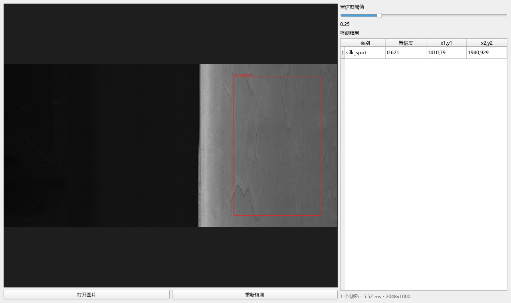
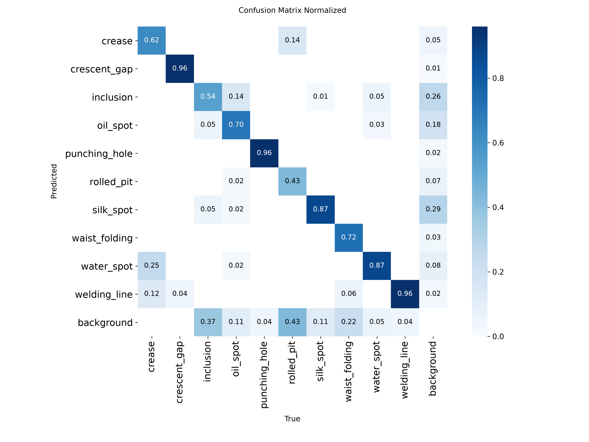
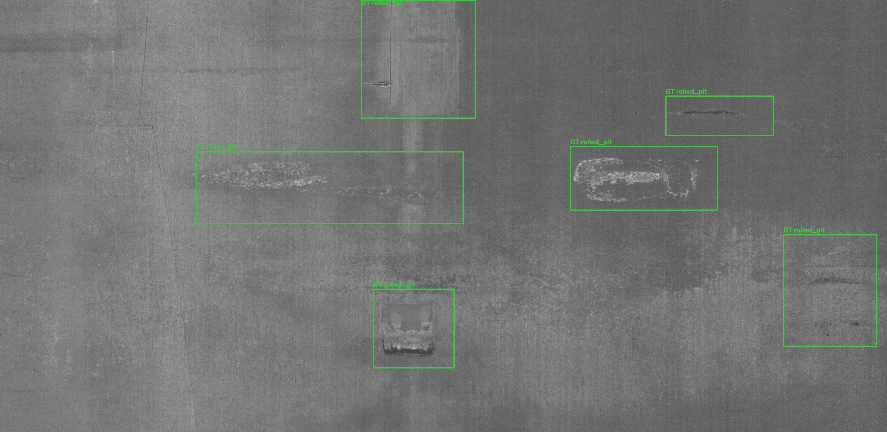
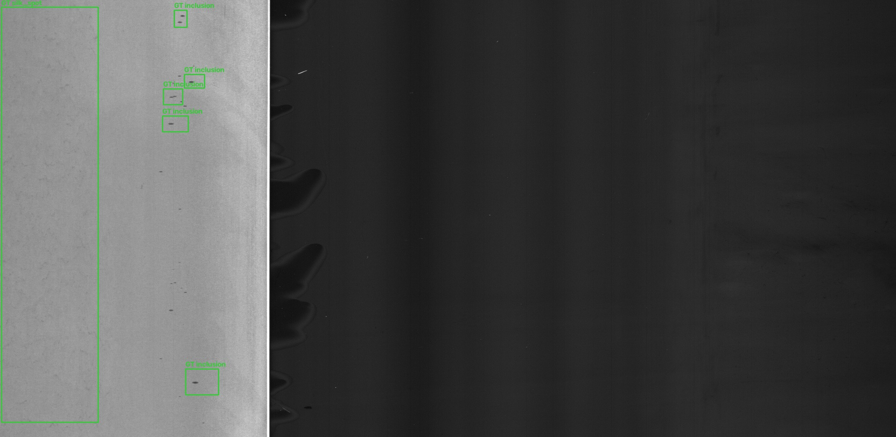
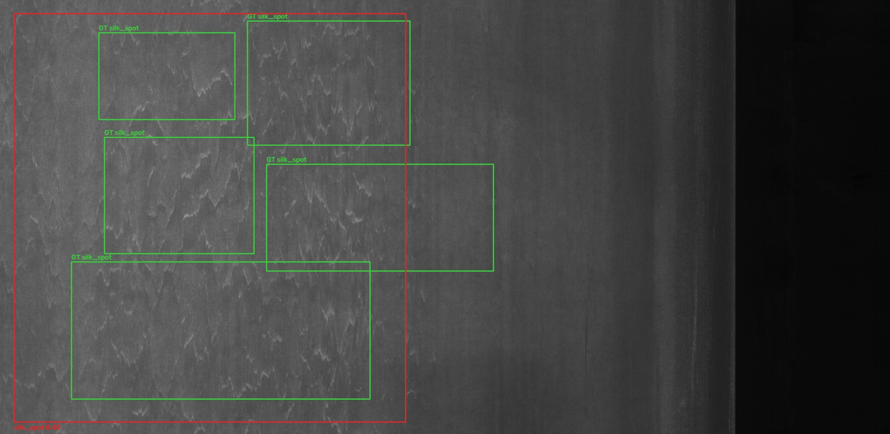

# Steel Surface Defect Detection — YOLOv8n → ONNX → PyQt6


> **TL;DR** — An end-to-end steel surface defect detection pipeline on the public GC10-DET dataset: YOLOv8n fine-tuning → ONNX export → FastAPI service → PyQt6 operator HMI, deployed CPU-only. Validation mAP@0.5 is 0.6248 and mAP@0.5:0.95 is 0.3473; pure single-image inference runs at 3.37 ms p50 on an AMD Ryzen 7 9800X3D. The repository keeps every measured number, the four investigations behind the missed 0.75 reference threshold, and the three documented failure cases, so the pipeline can be audited rather than demoed.

> **简介** — 用公开数据集 GC10-DET 走完一条工业缺陷检测的工程链路：数据准备 → 训练 → 评测 → 导出 ONNX → CPU 推理服务 → PyQt6 上位机。仓库的重点不是把 mAP 刷高，而是把每一环为什么这么选、代价是什么、换到真实产线上会怎么坏写清楚，并给出可复现的命令与实测数据。

---

## 1 项目概览（Overview）

### 1.1 效果预览



*PyQt6 上位机：左侧原图叠加红框检出结果，右侧为置信度阈值滑块与结果表格。另外两张不同阈值的截图见 [`docs/hmi_2_high.png`](docs/hmi_2_high.png) 与 [`docs/hmi_3_low.png`](docs/hmi_3_low.png)。*


*GC10-DET 单帧原图：2048×1000 单通道灰度，缺陷表现为亮带、暗斑或细线。*

### 1.2 这个仓库解决什么问题

用公开数据集 GC10-DET 完整复现一条工业缺陷检测链路：数据准备 → 训练 → 评测 → 导出 ONNX → CPU 推理服务 → PyQt6 上位机。目标是产出一份可公开核查的工程记录，而不是一个只能跑通 demo 的仓库。

**它不是刷 mAP 的项目。** 常见的工程门槛是 mAP@0.5 ≥ 0.75，本测试环境的结果是 **0.6248**，未达到该门槛。`docs/EVAL.md` 第 3.4 节记录了针对这个差距的四条排查，结论是差距来自真实约束而非实现缺陷。这份仓库更想讲清楚的是：每一环为什么这么选、代价是什么、换到真实产线上会怎么坏。

**公开数据集与企业实际产线的差距**写在 [`docs/LINE_ADAPTATION.md`](docs/LINE_ADAPTATION.md)：七条鸿沟（分辨率 / 色彩 / 尺度 / 类别定义 / 样本量 / 光照 / 成本），每条都带量化证据。

---

## 2 核心结果（Results）

### 2.1 总表

| 指标 | 值 | 说明 |
|---|---|---|
| **mAP@0.5** | **0.6248** | 验证集 230 张 / 349 框；单轮峰值在 ep81（0.6498） |
| **mAP@0.5:0.95** | **0.3473** | best.pt = ep95；Ultralytics 以该指标选模 |
| **Precision / Recall** | **0.5923 / 0.6479** | 各自 F1 最优点 |
| **CPU 推理延迟（纯推理）** | **3.37 ms** p50 | 320×320，mean 3.54 / p95 4.65 / p99 4.82 |
| **CPU 推理延迟（端到端）** | **5.54 ms** p50 | 2048×1000 原图，mean 5.70 / p95 6.78 / p99 7.03 |
| **ONNX 体积** | **12.0 MB** FP32 / **6.0 MB** FP16 | opset 17，静态 shape |
| 模型 | YOLOv8n（COCO 预训练微调） | 3,140,190 参数（融合后 3,134,894） |
| 训练配置 | imgsz=**320**，batch=16，100 epochs，**seed=42**，deterministic=true | RTX 5070 12GB，36.7 min，显存 0.594 GB |
| 数据集 | GC10-DET，2300 张（1840 / 230 / 230） | 3563 个标注框，原图 2048×1000 灰度，928 MB |
| 服务 | `/predict` p50 7.35 ms ≈ 136 QPS | 进程启动到 `/health` 可用 701.71 ms；模型加载 + warmup 71.87 ms |

**关于这个 0.6248**：参考门槛是 mAP@0.5 ≥ 0.75，实测未达到。`docs/EVAL.md` 第 3.4 节有完整的四条排查记录，结论是「不是 bug，是 6.4 倍下采样损失小目标 + 类别定义歧义 + 长尾样本不足的真实结果」。小目标类别（inclusion / rolled_pit）的失效是 320 输入的固有代价，这一点在 `docs/LINE_ADAPTATION.md` 第 1 节展开。

### 2.2 逐类指标

| 类别 | P | R | mAP@0.5 | mAP@0.5:0.95 | 训练集实例数 |
|---|---|---|---|---|---|
| crescent_gap（月牙缺口） | 0.780 | 0.958 | **0.907** | 0.629 | 207 |
| water_spot（水斑） | 0.753 | 0.846 | 0.844 | 0.544 | 286 |
| punching_hole（冲孔） | 0.928 | 0.920 | 0.942 | 0.523 | 263 |
| welding_line（焊缝线） | 0.708 | 0.956 | 0.890 | 0.501 | 418 |
| waist_folding（腰部折） | 0.838 | 0.722 | 0.664 | 0.334 | 115 |
| silk_spot（丝斑） | 0.552 | 0.646 | 0.639 | 0.284 | 698 |
| crease（折痕） | 0.336 | 0.375 | 0.464 | 0.270 | 55 |
| oil_spot（油斑） | 0.500 | 0.571 | 0.552 | 0.262 | 453 |
| inclusion（夹杂） | 0.307 | 0.341 | 0.248 | 0.083 | 276 |
| rolled_pit（轧制坑） | 0.223 | 0.143 | 0.099 | 0.042 | 77 |
| **all** | **0.592** | **0.648** | **0.625** | **0.347** | 2848 |

**三个梯队界限清楚**：形变大、对比度高的（月牙缺口、冲孔、焊缝线）全部 > 0.89；长尾且类内差异大的（腰部折、丝斑、折痕）在 0.46–0.66；小目标、低对比度的（油斑、夹杂、轧制坑）全部 < 0.56。

### 2.3 混淆矩阵



**三个结论**（详细读图见 `docs/EVAL.md` 第 3.3 节）：

1. **主要问题是漏检，不是混类。** rolled_pit 有 42.9% 被判成背景，inclusion 36.6%。这两类是「压根没看见」，不是「看见了标错」。
2. **真正存在的互混只有三对**：`oil_spot → inclusion` 14%（同为暗斑，边缘锐度差异被 320 抹平）、`crease → water_spot` 25%（折痕在反光面上的亮度分布像水斑，需要工艺知识才能区分）、`rolled_pit → crease` 14%（坑沿的线性高光）。
3. crease ↔ water_spot 的 25% 互混**不是模型能力问题**，是标注口径问题。这一条已写进 `docs/LABEL_SPEC.md` 并用规则钉死。

### 2.4 失败案例

| 图 | 案例 | 困难类型 |
|---|---|---|
|  | 6 个轧制坑，**0 检出** | 小目标：缩到 320 后最大只剩 47×39 px，且无锐利边缘 |
|  | 5 个夹杂 + 1 个丝斑，**0 检出** | 小目标 + 低对比度：框仅 30–60 px，与背景灰度差 < 20 灰阶 |
|  | 5 个重叠丝斑，**只检出 1 个大框** | 尺度跨 10 倍 + 框互相重叠，NMS 把候选全压掉 |

绿框 = 真值，红框 = 模型检出。三张案例的共同点：**都不是认错类别，是压根没看见。**

### 2.5 CPU 推理延迟

| 环节 | mean | p50 | p95 | p99 |
|---|---|---|---|---|
| 纯推理（320×320） | 3.54 ms | **3.37 ms** | 4.65 ms | 4.82 ms |
| 端到端（200×200） | 4.61 ms | 4.43 ms | 5.80 ms | 6.01 ms |
| 端到端（2048×1000） | 5.70 ms | **5.54 ms** | 6.78 ms | 7.03 ms |

端到端含 letterbox 缩放 → 归一化 → ONNX 推理 → NMS → 坐标反变换。预热 10 次、计时 100 次，**320 与 640 交替跑 3 轮取中位数**（单独跑容易受当时负载影响；早期一次测量因后台正在训练 640 模型，把所有数字抬高了 20% 以上，详见 `docs/EVAL.md` 第 5.2 节）。

**参考硬件**：AMD Ryzen 7 9800X3D，4 线程，onnxruntime 1.31.1（`platform.processor()` 返回 `AMD64 Family 26 Model 68 Stepping 0, AuthenticAMD`）。这是高端桌面 CPU，**工控机上常见的 i5-1235U 会慢 3–8 倍，必须在目标硬件上重测**。

---

## 3 快速开始（Quick Start）

以下命令均在仓库根目录执行，路径全部为相对路径。

### 3.1 安装依赖

```bash
pip install -r requirements.txt         # 推理 / 服务（纯 CPU，不含 torch）
pip install -r requirements-dev.txt     # 训练 / 评测 / 上位机（含 torch、ultralytics、PyQt6）
```

不想用依赖文件时的单行等价命令（版本号即仓库实测环境）：

```bash
pip install onnxruntime==1.31.1 numpy opencv-python fastapi uvicorn python-multipart
```

`requirements.txt` 与该命令的差异只有两点：用 `>=` 而非 `==` 作为版本下界，以及用 `opencv-python-headless` 代替 `opencv-python` 以减小部署体积（两者的 `import cv2` 完全一致）。`PyQt6` 只在跑上位机时需要，因此归在 `requirements-dev.txt`。`scripts/test_api.py` 只用标准库 `urllib` 拼 multipart 请求，不依赖 `requests`。

> **推理侧不需要 PyTorch，也不需要 CUDA。** 训练环境用 ultralytics + torch，部署环境只要 CPU 版 onnxruntime。

### 3.2 下载并准备数据

```bash
python scripts/download_gc10.py        # 从 hf-mirror 拉 GC10-DET（2300 图 / 2300 标注，928 MB）
python scripts/make_splits.py          # 生成 splits/{train,val,test}.txt
python scripts/check_labels.py         # 六项标注质检 + 逐类实例数 + 重复图检查
```

> 下载脚本是线程池并发版（8 线程实测 2.62 MB/s，串行只有 0.30 MB/s）；遇到 hf-mirror 429 限流时用 `scripts/retry_missing.py` 低并发补传。

### 3.3 训练与导出

```bash
python train.py --data data/gc10/data.yaml --epochs 100 --batch 16 --imgsz 320 --name train
python scripts/eval.py --split val        # 注意是 val 不是 valid
python export_onnx.py                     # 导出 FP32 + FP16 两份
python verify_onnx.py                     # 核对 shape / opset / 与 torch 的一致性
```

> **Windows 必须 `workers=0`**，否则触发 `WinError 5`。`train.py` 里已经写死并注释了原因。

### 3.4 拿到模型文件

仓库**不包含模型权重**：`.pt` 与 `.onnx` 都是 12 MB 级的二进制，进版本库会让 clone 变慢、也不方便按版本替换。两条路取其一：

```bash
# 路线 A：从 Release 下载预导出的 ONNX（推荐，跳过训练）
#   在仓库的 Releases 页面下载 best_fp32.onnx / best_fp16.onnx，
#   放进 exports/ 即可。文件大小分别是 12.0 MB 与 6.0 MB。

# 路线 B：自己训练并导出（需要 GPU，约 37 min）
python train.py --data data/gc10/data.yaml --epochs 100 --batch 16 --imgsz 320 --name train
python export_onnx.py                     # 导出 FP32 + FP16 两份，落在 exports/
python verify_onnx.py                     # 核对 shape / opset / 与 torch 的一致性
```

后续的推理服务与上位机都按 `exports/best_fp32.onnx` 这个相对路径找模型，所以两条路线产物位置一致，下游命令不用区分。

### 3.5 起推理服务

```bash
python serve/main.py       # 终端 1：默认 127.0.0.1:8000
python scripts/test_api.py # 终端 2：手工拼 multipart 测接口
```

接口：

```text
GET  /health   → {"ok": true, "model": "best_fp32.onnx", "imgsz": 320, "conf": 0.25, "classes": 10}
POST /predict  → multipart/form-data，字段名 file（写成 image 会返回 422）
```

一行命令试一下（换成你自己的图片路径也行）：

```bash
curl -s -F "file=@docs/sample.jpg" http://127.0.0.1:8000/predict
```

返回：

```json
{
  "detections": [{"cls": 6, "name": "silk_spot", "conf": 0.6211,
                  "xyxy": [1410.4, 78.8, 1940.5, 929.3]}],
  "elapsed_ms": 7.35,
  "image_size": [2048, 1000]
}
```

### 3.6 起上位机

```bash
python hmi/app.py          # 或双击 launch_hmi.bat（Windows）
```

服务端可由环境变量覆盖行为：`DSI_ONNX`（模型路径，默认 `exports/best_fp32.onnx`）、`DSI_CONF`（置信度阈值，默认 0.25）、`DSI_PORT`（监听端口，默认 8000）。

上位机不走 HTTP，而是直接在本进程内加载 ONNX 做推理，模型路径固定为 `exports/best_fp32.onnx`（见 `hmi/app.py`）。要换模型，改这一处或改用上面的服务接口。

### 3.7 参考环境

Python 3.x + torch 2.14.1+cu130 + ultralytics 8.4.211 + onnx 1.23.2 + onnxruntime 1.31.1 + opencv 5.0.0 + PyQt6。参考硬件：RTX 5070 12GB 训练 / AMD Ryzen 7 9800X3D CPU 推理（4 线程）。

---

## 4 项目结构（Project Structure）

```text
steel-defect-inspect/
├── README.md
├── LICENSE                   # MIT，仅覆盖本仓库自身代码与文档
├── NOTICE                    # 第三方组件与数据集归属
├── CONTRIBUTING.md
├── CHANGELOG.md
├── requirements.txt          # 推理 / 服务端依赖
├── requirements-dev.txt      # 训练与评测依赖
├── .editorconfig
├── train.py                  # 训练入口（workers=0 写死，project 绝对路径）
├── export_onnx.py            # 导出 FP32 + FP16
├── verify_onnx.py            # 核对 shape / opset + 与 torch 一致性
├── shim.py                   # 替换 ultralytics 的 ThreadPool（Windows 上会崩）
├── launch_hmi.bat            # Windows 一键起上位机
├── scripts/
│   ├── download_gc10.py      # 线程池并发下载（8 线程 2.62 MB/s）
│   ├── retry_missing.py      # 429 限流补传（2 线程 + 指数退避）
│   ├── make_splits.py        # 清点 img↔label pair，落 splits/*.txt
│   ├── check_labels.py       # 六项质检 + 逐类实例数 + pHash 重复图
│   ├── eval.py               # m.val() + 逐类 markdown 表（--split val）
│   └── test_api.py           # 手工拼 multipart 测接口（不依赖 curl）
├── bench/
│   ├── latency.py            # 三层延迟基准（推理 / e2e 小图 / e2e 原图）
│   ├── compare_imgsz.py      # 320 与 640 的对照实验
│   ├── recall_at_conf.py     # 固定 conf 阈值下的召回
│   ├── startup.py            # 进程启动 → 模型可用耗时
│   └── startup_http.py       # 进程启动 → /health 可用耗时
├── serve/
│   ├── infer.py              # Detector：ONNX 自读 imgsz、letterbox、NMS
│   └── main.py               # FastAPI，/health + /predict
├── hmi/
│   ├── app.py                # PyQt6 上位机（阈值滑块 + 结果表格）
│   └── _shot.py              # offscreen 截图（含中文字体加载）
├── splits/                   # train 1840 / val 230 / test 230（md5 可查）
├── exports/                  # 模型目录（*.onnx 不入库，从 Releases 取或自行导出）
├── runs/detect/train/        # 训练产物 22 个文件（png + csv 入库，权重排除）
├── tests/                    # 合成小数据集（64 张，用于管线自测）
├── data/gc10/                # 数据集（.gitignore 排除，928 MB）
└── docs/
    ├── EVAL.md               # 评测报告：数据集 / 超参 / 逐类 / 混淆矩阵 / 失败案例 / 性能
    ├── LINE_ADAPTATION.md    # 七条鸿沟：公开数据集 → 真实产线
    ├── LABEL_SPEC.md         # 十类定义 + 正反例 + 边界案例 + 双人标注流程
    ├── DEPLOY_NOTES.md       # 部署形态 / 体积 / 启动 / 并发 / 已知限制 / 上线清单
    ├── VERIFICATION.md       # 逐步实操验证：每条命令的预期输出
    ├── DEVELOPMENT_LOG.md    # 开发日志：每个环节的实测记录与逐项对账
    ├── QA_CHECKLIST.md       # 质量核对表
    ├── PAPER.md              # 技术报告全文
    └── *.png, *.jpg          # 上位机截图 3 张 + 失败案例 3 张 + 样本图 + label_check.csv
```

### 4.1 关于 `splits/`

`splits/{train,val,test}.txt` 每行一个图片路径，分别是 1840 / 230 / 230 行，合计 2300 = 数据集图片总数。

**这三份文件不重新划分数据集**，而是沿用上游镜像自带的划分。原因：GC10-DET 没有官方划分标准，各仓库切法不同，重新切会让结果无法与任何公开数字对照。三个文件跑两次 md5 完全相同（可复现性验证），且 `scripts/make_splits.py` 会检查 img↔label 是否配对（本项目实测 `paired 1840 / img-only 0 / lbl-only 0`）。

### 4.2 关于 `seed=42`

`train.py` 固定 `seed=42` + `deterministic=true`，与 splits 的划分配套。不固定种子时同一份数据每次跑 mAP 会差 2–3 个百分点，测得的数字也就失去可比性。

### 4.3 复现全流程

```bash
git clone <repo> && cd steel-defect-inspect

python scripts/download_gc10.py && python scripts/make_splits.py && python scripts/check_labels.py
python train.py --data data/gc10/data.yaml --epochs 100 --batch 16 --imgsz 320 --name train
python scripts/eval.py --split val
python export_onnx.py && python verify_onnx.py
python bench/latency.py --repeats 3
python serve/main.py &
python scripts/test_api.py
python hmi/_shot.py
```

逐项实测记录在 [`docs/DEVELOPMENT_LOG.md`](docs/DEVELOPMENT_LOG.md)，包括与一组**项目开始时设定的参考数字**的对账（说明见 [`docs/QA_CHECKLIST.md`](docs/QA_CHECKLIST.md) 第 7 节；另含三处口径差异：目录数 9 vs 10、训练产物 9 vs 13、图片数 2300 vs 2303）。

---

## 5 文档索引（Docs Index）

| 文档 | 回答什么问题 |
|---|---|
| [`docs/EVAL.md`](docs/EVAL.md) | 模型到底多准？错在哪？为什么错？ |
| [`docs/LINE_ADAPTATION.md`](docs/LINE_ADAPTATION.md) | 公开数据集和真实产线差在哪？怎么处理？（建议先读） |
| [`docs/LABEL_SPEC.md`](docs/LABEL_SPEC.md) | 十类怎么定义？边界案例算不算？ |
| [`docs/DEPLOY_NOTES.md`](docs/DEPLOY_NOTES.md) | 怎么部署？多大体积？多少并发？有什么坑？ |
| [`docs/VERIFICATION.md`](docs/VERIFICATION.md) | 怎么一步步验证这个项目是真的训练出来的？每步的预期输出是什么？ |
| [`docs/DEVELOPMENT_LOG.md`](docs/DEVELOPMENT_LOG.md) | 每一环的实测记录与逐项对账是怎么做的？ |
| [`docs/QA_CHECKLIST.md`](docs/QA_CHECKLIST.md) | 发布前的质量核对都查了哪些项？ |
| [`docs/PAPER.md`](docs/PAPER.md) | 系统的完整技术报告与实验设计是什么？ |

---

## 6 设计取舍（Design Decisions）

### 6.1 为什么输入是 320，不是 640

原图 2048×1000，缩到 320 是 **6.4 倍下采样**，代价明确：小目标类别（inclusion 0.248、rolled_pit 0.099）几乎失效。

**这不是拍脑袋的折中，两个分辨率都训练完了**（同超参、同 seed、各 100 epochs）：

| | 320（默认） | 640（可选） |
|---|---|---|
| mAP@0.5 | 0.6248 | **0.6552**（+3.0pp） |
| 固定 conf=0.25 的召回 | 0.6304 | **0.6562**（+2.6pp） |
| e2e 2048×1000 p99 | **7.03 ms** | 25.14 ms（3.6×） |
| 训练显存 | **0.594 GB** | 2.11 GB（3.55×） |
| 训练耗时 | **36.7 min** | 57.4 min（1.56×） |

640 确实更准，而且在**同一固定阈值下召回也更高**（不是拿召回换精确率——ultralytics 报的 P/R 是各自 F1 最优点，直接比会读错，详见 `docs/EVAL.md` 第 3.5.3 节）。

仍选 320 作默认，理由按重要性排序：

- **640 同样没过 0.75 的参考门槛**。0.655 一样不达标，换它并不改变这一事实。
- **延迟余量留给现场**。产线 30 fps 预算 33 ms，640 的 e2e p99 占掉 25.14 ms，只剩 24% 余量；320 只占 7.03 ms，留了 79%。现场一旦要多路、或换成彩色三通道预处理，640 立刻不够。
- **参考数字可比性**。整张 25 项对账表是按 320 建立的，换默认模型会让十几行数字失去可比性。

**640 不是弃子**，换一行环境变量即可：

```bash
set DSI_ONNX=exports\best640_fp32.onnx    # Windows cmd
python serve/main.py                      # /health 会自动报 imgsz: 640
```

两份 ONNX 都能跑（从 Releases 下载，或用 `export_onnx.py` 自行导出）。这是「量过、随时能换」，不是「只能用 320」。

### 6.2 为什么关掉上下翻转（flipud=0）

左右镜像（fliplr=0.5）开着，上下翻转**必须关**：钢带缺陷的「划痕方向」「氧化皮堆积方向」有物理语义，上下翻转会造出现实中不存在的样本。模型会学到「倒置的划痕也是划痕」，到产线上遇到正常方向的缺陷反而不敏感。

同理 `degrees=0`、`shear=0`、`perspective=0`——产线相机固定正拍，做几何畸变增强是拿训练时间换噪声。

### 6.3 为什么灰度图只扰亮度（hsv_h=0, hsv_s=0, hsv_v=0.3）

GC10-DET 是单通道灰度图，做色相 / 饱和度扰动在数学上等于没扰动（三个通道值相同）。只保留 `hsv_v=0.3` 模拟曝光波动——这是产线上真实会发生的（灯管老化）。其余两项直接关掉，不留一个看起来在增强的默认值。

### 6.4 为什么 FP16 反而更慢，所以生产用 FP32

FP16 导出体积确实减半（12.0 → 6.0 MB），但：

| 模型 | 与 PyTorch 输出最大绝对差 | 平均绝对差 |
|---|---|---|
| FP32 | **5.95e-04** | 4.71e-06 |
| FP16 | **1.09e+00** | 9.66e-03 |

FP16 的误差 **1.09 已经超过 1 个类别分数**，会翻转 NMS 的 score 排序。而且 x86 消费级 CPU 没有原生 FP16 算力，onnxruntime 必须反量化回 FP32 再算，多一层开销，**端到端反而慢约 30%**。

**结论**：CPU 部署一律 FP32。FP16 那份仍一并导出到 `exports/`，作为「将来上 GPU 可以直接用」的备选。

### 6.5 为什么阈值做成滑块，交给工艺工程师

这是**成本决策，不是技术参数**。钢带产线上：误检 = 停线复判（数千到数万元/次），漏检 = 客诉索赔（数万到数十万/次 + 丢单）。两者差一个量级，所以阈值该压低——但压太低会把复判工作量炸掉。

[`docs/hmi_3_low.png`](docs/hmi_3_low.png) 就是微观演示：阈值从 0.25 降到 0.05，同一个 silk_spot 区域多出一个 `conf=0.081` 的重复框。

**算法工程师不知道当期是赶交期还是客诉敏感期**，所以默认给 0.25（偏保守、宁可多报），滑块范围 5–95 让工艺工程师自己调。一个调不动的黑盒在产线上活不过三个月。

### 6.6 为什么模型加载时主动 warmup

`serve/main.py` 在 lifespan 里加载模型后立刻跑 3 次零张量 warmup。不做这一步，第一个真实请求要等 50 ms 左右（内存分配 + onnxruntime 图优化），这个抖动在产线上直接影响节拍。**服务一旦返回 `/health ok:true`，就必须是随时可接受请求的状态。**

---

## 7 已知限制（Known Limitations）

| 短板 | 量化证据 | 影响 |
|---|---|---|
| **小目标召回差** | inclusion mAP@0.5 = 0.248（漏检 36.6%）、rolled_pit = 0.099（漏检 42.9%） | 若产线主要缺陷是这两类，本模型不能直接用 |
| **mAP 未达 0.75 参考门槛** | 实测 0.6248（640 对照 0.6552，同样不达标） | 见 `docs/EVAL.md` 第 3.4 节的四条排查、第 3.5 节的消融 |
| **crease ↔ water_spot 互混 25%** | 混淆矩阵 | 是标注口径问题，改模型无效 |
| **彩色反光场景未验证** | 训练数据全为灰度图 | 投产前必须用产线实拍图验证 |
| **无鉴权 / 无限流** | 只有本地绑定 | 对外暴露必须加网关 |
| **学术数据与产线数据存在系统性差异** | 七条鸿沟，逐条量化 | 换数据集必须先做迁移评估，见 `docs/LINE_ADAPTATION.md` |

小目标召回是这一版最主要的瓶颈：320 输入下，inclusion 与 rolled_pit 的框缩到 30–60 px、与背景灰度差不足 20 灰阶，模型基本「看不见」而不是「认错」。这个问题不会因为调阈值或换 NMS 参数消失，只能在更高输入分辨率、切片推理或数据侧补样本上解决，而每一种都要付出第 6.1 节里那张表的代价。

详细分析见 [`docs/EVAL.md`](docs/EVAL.md) 和 [`docs/LINE_ADAPTATION.md`](docs/LINE_ADAPTATION.md)。

---

## 8 许可与致谢（License & Credits）

本仓库**自身的代码与文档**以 **MIT** 协议发布，全文见 [`LICENSE`](LICENSE)。但有两个第三方约束必须一并交代：

| 范围 | 许可 | 说明 |
|---|---|---|
| 本仓库代码与文档 | MIT | 见 `LICENSE` |
| `exports/*.onnx`、`runs/**/weights/*.pt` | **AGPL-3.0** | 由 Ultralytics YOLOv8 衍生而来，不适用 MIT |
| GC10-DET 数据集 | 归原作者所有 | 本仓库不重新分发数据（`data/` 已在 `.gitignore` 中排除），只提供下载脚本 |

**Ultralytics YOLOv8** 以 AGPL-3.0 发布。凡是用它训练或导出的产物（权重与 ONNX）都属于 AGPL-3.0 衍生物，不适用本仓库的 MIT 条款。商用部署——尤其是中小企业闭源部署——需要自行评估 Ultralytics 的商业授权方案；本段不构成法律意见。

**GC10-DET** 是公开的钢带表面缺陷数据集，版权归其作者。本仓库只引用、不重新分发，克隆后需要自行运行 `scripts/download_gc10.py` 获取。

更完整的第三方组件清单与数据来源链接见 [`NOTICE`](NOTICE)。贡献方式见 [`CONTRIBUTING.md`](CONTRIBUTING.md)，版本变更见 [`CHANGELOG.md`](CHANGELOG.md)。
