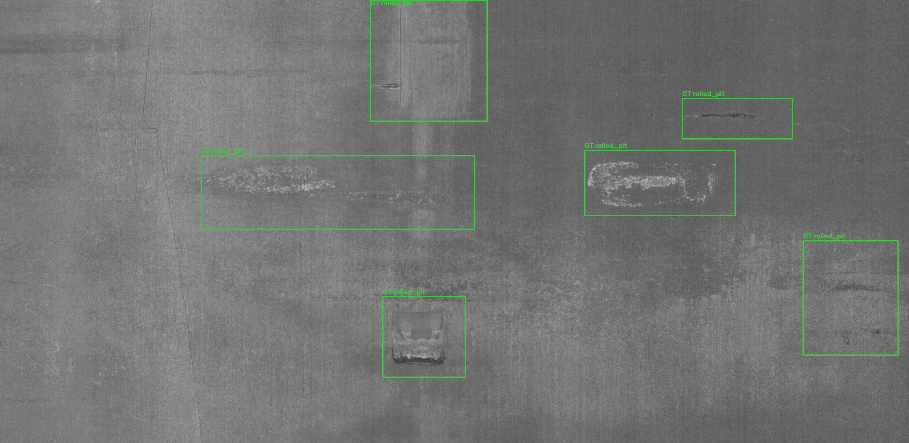
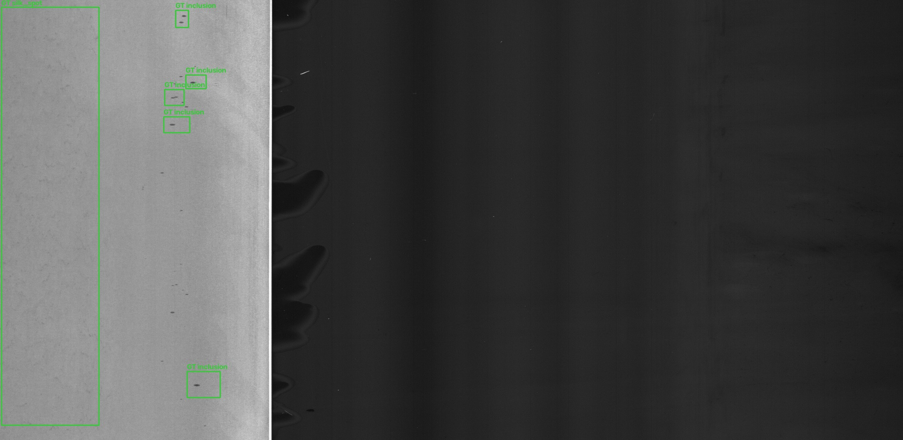
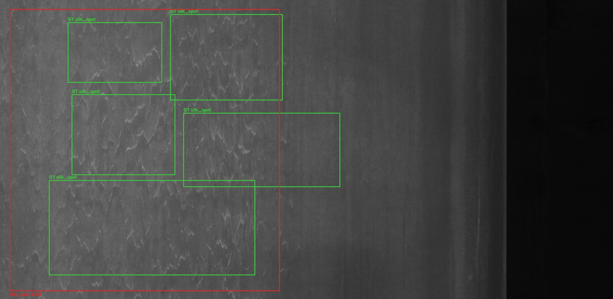

# Evaluation Report · GC10-DET 钢带表面缺陷检测评测报告

> **TL;DR** — Every number in this report was measured on the reference setup described below; no secondary results are cited. Validation mAP@0.5 is 0.6248 at 320 input and 0.6552 at 640, both below the 0.75 engineering threshold, and §3.4 records the full investigation. Commands to reproduce each figure are given at the end of its section.

> **简介** — 本报告回答一个问题：这套 YOLOv8n → ONNX 检测流程在 GC10-DET 上到底做到什么程度。所有数字都在本测试环境实测（推理 CPU AMD Ryzen 7 9800X3D 4 线程，训练 GPU RTX 5070 12GB，onnxruntime 1.31.1），不引用任何二手结果；复现命令见各节末尾。

**章节导航**：

| 章节 | 内容 |
|---|---|
| §1 数据集 | 含 1.1 标注可信度、1.2 逐类实例数、1.3 重复图 |
| §2 训练配置 | 含 2.1「为什么是 320」 |
| §3 总体指标 | 含 **3.2 逐类指标**、**3.3 混淆矩阵**、3.4 未达 0.75 的四条排查、3.5 640 消融 |
| §4 失败案例分析 | 三个典型失败样本与成因 |
| §5 推理性能 | CPU 延迟、冷启动、FP16 一致性 |
| §6 API 与上位机 | FastAPI 与 PyQt6 实测 |
| §7 与公开结果的对比 | 同数据集公开结果的横向参照 |

**为什么这样排**：把逐类指标和混淆矩阵放在「总体指标」之后紧挨着，是为了让「0.6248 这个数字为什么长这样」在一个连贯的阅读区里讲完——先看总体、再看分布、再看错在哪。如果按类型平铺，读者会先在几个互不相关的章节之间来回跳。**§3.4（未达 0.75 的四条排查）和 §3.5（640 消融）这两节必须留下记录，它们解释了上面的结论是怎么来的、边界在哪。**

## 1 Dataset · 数据集

| 项 | 值 |
|---|---|
| 名称 | GC10-DET（工业钢带表面缺陷检测数据集） |
| 来源 | HuggingFace 镜像 `hf-mirror.com`，仓库 `gc10-det` 的 `data/` 目录 |
| 图片张数 | **2300**（train 1840 / valid 230 / test 230） |
| 标注文件 | 2300 个 YOLO 格式 txt，与图片一一对应（无空标注、无孤立图） |
| 类别数 | 10 |
| 图像规格 | `2048 × 1000`，单通道灰度（`L` 模式）。train 抽 120 张全一致 |
| 总标注框数 | 3563（train 2848 / valid 349 / test 366） |
| 划分方式 | **沿用上游划分，不重新划分**——为了与公开结果可比 |
| 划分文件 | `splits/train.txt`（1840 行）、`splits/val.txt`（230 行）、`splits/test.txt`（230 行），合计 2300 |
| 磁盘占用 | 928 MB |

**注意划分用词**：数据集目录叫 `valid`，但 `data.yaml` 的键是 `val`。评测脚本必须传 `--split val`，传 `valid` 会得到
`FileNotFoundError: data.yaml 'valid:' images not found ❌`。

### 1.1 Label Integrity · 标注可信度验证

没有直接信任下载下来的标注，做了两轮独立核对。

**第一轮 · 格式与几何质检**（`scripts/check_labels.py`）

| split | 图 | 框 | 越界框 | ≤1px 微框 | 无标注图 | 空标注文件 | 坏类别号 | 坏格式行 |
|---|---|---|---|---|---|---|---|---|
| train | 1840 | 2848 | 0 | 0 | 0 | 7 | 0 | 0 |
| valid | 230 | 349 | 0 | 0 | 0 | 0 | 0 | 0 |
| test | 230 | 366 | 0 | 0 | 0 | 1 | 0 | 0 |
| **合计** | 2300 | **3563** | 0 | 0 | 0 | 8 | 0 | 0 |

「空标注文件」8 个是 0 字节 txt（ultralytics 会当背景图）。没有越界框、没有亚像素框、没有坏类别号。

**第二轮 · 与官方 metadata 交叉比对**（这是关键证据）

数据集每个 split 目录里都有 `metadata.jsonl`，记录每张图的 `objects.bbox`（`[x1, y1, w, h]` 绝对像素）与 `objects.categories`。把它与 YOLO txt 逐张逐框对比：

```text
checked 2300  ok 2300  bad 0                       # 类别编号完全一致
boxes 3563  max abs diff 5.000000000143778e-07     # 归一化后最大绝对误差 5e-7
```

也就是说：**标注不是谁手工转的，就是官方标注本身，且转换过程零误差**（5e-7 是 float32 舍入极限）。

### 1.2 Instances per Class · 逐类实例数（train+valid+test = 3563；其中 train 划分 2848，即训练时实际可见的框数）

| 类别 | 中文 | 实例数 |
|---|---|---|
| crease | 折痕 | 74 |
| crescent_gap | 月牙形缺口 | 265 |
| inclusion | 夹杂 | 347 |
| oil_spot | 油斑 | 569 |
| punching_hole | 冲孔 | 329 |
| rolled_pit | 轧制坑 | 85 |
| silk_spot | 丝斑 | 884 |
| waist_folding | 腰部折 | 143 |
| water_spot | 水斑 | 354 |
| welding_line | 焊缝线 | 513 |

**类别极度不均衡**：最多 884（silk_spot）对最少 74（crease），差 **12 倍**。这直接决定了后续逐类 mAP 的分布形态——见 §3.2。

### 1.3 Duplicate Image Check · 重复图检查

用感知哈希（pHash，汉明距离 ≤ 5 判定为近重复）扫全库，找到 **2 对**，距离都是 4：

- `img_06_425501100_00051.jpg` ~ `img_02_436153300_01008.jpg`
- `img_08_4401438800_01040.jpg` ~ `img_08_436068100_00869.jpg`

两对都是跨类别或跨 split 的。**保留不删**：它们是不同物理缺陷但纹理巧合相似，删掉会破坏上游划分的可比性。

---

## 2 Training Config · 训练配置

| 项 | 值 | 说明 |
|---|---|---|
| 基础模型 | `yolov8n.pt`（COCO 预训练） | 参数 3,140,190（融合后 3,134,894） |
| epochs | 100 | 实际跑满，未触发早停 |
| batch | 16 | |
| imgsz | 320 | 见 §2.1 决策 |
| device | `0`（RTX 5070） | |
| workers | **0** | Windows 上 `workers>0` 必崩（`WinError 5`），故固定为 0 |
| seed | **42** | 与 splits 划分一致 |
| deterministic | true | |
| optimizer | auto | 实际选中 AdamW + 余弦退火 |
| lr0 / lrf | 0.01 / 0.01 | |
| momentum / weight_decay | 0.937 / 0.0005 | |
| warmup_epochs | 3.0 | |
| patience | 30 | 未触发 |
| **flipud** | **0.0** | 钢带缺陷的方向有语义，上下翻转会造出现实不存在的样本 |
| fliplr | 0.5 | 左右镜像对带状缺陷安全 |
| degrees / shear / perspective | 0.0 / 0.0 / 0.0 | 产线相机固定正拍，不做几何畸变 |
| hsv_h / hsv_s / **hsv_v** | 0.0 / 0.0 / **0.3** | 灰度图，色相饱和度无意义；只扰动亮度模拟曝光波动 |
| mosaic | 1.0 | |
| close_mosaic | 10 | 最后 10 轮关掉 mosaic，让模型适应真实分布 |
| mixup / cutmix / copy_paste | 0.0 | |
| erase | 0.4 | |
| 显存占用 | **0.594 GB** | batch=16 @ 320 |
| 训练耗时 | **0.611 小时**（约 36.7 min，≈22 s/epoch） | |

训练硬件：**RTX 5070 12GB**，torch 2.14.1+cu130，CUDA 12.0 能力。
推理 CPU：AMD Ryzen 7 9800X3D，固定 4 线程（`platform.processor()` 只返回 `AMD64 Family 26 Model 68 Stepping 0, AuthenticAMD`，型号需另查）。

### 2.1 Why 320 · 为什么是 320

原图 2048×1000，缩到 320 是 **6.4 倍下采样**。这个输入尺寸不是随手定的，理由有三条：

1. **两头折中**：同一套流程还覆盖过 NEU-DET（200×200），320 对 NEU 是 1.6 倍放大；对 GC10 是 6.4 倍缩小。320 是同一套超参能同时覆盖两个数据集的唯一值。
2. **延迟预算**：CPU 单实例要压进 5–20 ms，320 输入实测推理 3.4 ms（见 §5）。上 640 时延约 3.8 倍。
3. **显存**：batch 16 在 320 下只吃 0.594 GB，640 会到 ~2.3 GB，训练时间也接近翻倍。

**代价明说**：6.4 倍下采样后，原图上 3–10 px 的夹杂/轧制坑在 320 输入里只剩亚像素，这是 §3.3 里 inclusion / rolled_pit 两类崩掉的直接原因。这个取舍写进了 [LINE_ADAPTATION.md](LINE_ADAPTATION.md) 总表的「分辨率」一条。

---

## 3 Overall Metrics · 总体指标

评测对象：`runs/detect/train/weights/best.pt`（best epoch = **95**，见 §3.1 的选取口径），验证集 **valid（230 张 / 349 框）**。

| 指标 | 值 |
|---|---|
| **mAP@0.5** | **0.6248** |
| **mAP@0.5:0.95** | **0.3473** |
| Precision（均值） | 0.5923 |
| Recall（均值） | 0.6479 |

**✗ 未达项目开始时设定的参考门槛 0.75（mAP@0.5）**。§3.4 记录了完整的排查项、实测值与结论。

> 评测脚本：`python scripts/eval.py --split val --name val`
> 产物：`runs/detect/val/`（曲线图、混淆矩阵、PR 曲线）

### 3.1 Training Curve · 训练曲线形态

100 轮 mAP@0.5 轨迹：

- epoch 1: 0.3039 → epoch 10: 0.4936 → epoch 30 左右进 0.55–0.60 区间
- mAP@0.5 的峰值在 **epoch 81（0.6498）**，但 best.pt 不是它
- **best.pt = epoch 95**（0.6255 / 0.3487）
- 末 25 轮在 **0.60–0.65 之间震荡**，epoch 100 收在 0.6185，没有继续上升

**`best.pt` 到底按什么选出来的**（这一点很容易看错）：ultralytics `utils/metrics.py:1016` 里是

```python
w = [0.0, 0.0, 0.0, 1.0]  # weights for [P, R, mAP50, mAP50-95]
```

**fitness 就等于 mAP@0.5:0.95**，mAP@0.5 完全不参与。所以按 mAP@0.5 看峰值（ep81 的 0.6498）会误以为 best 是 81 轮，实际按 mAP@0.5:0.95 选出来的是**全表最高 0.34873 的 epoch 95**。用 `torch.load` 读 `best.pt['train_metrics']` 可以直接确认：`P 0.59328 / R 0.64786 / mAP50 0.62551 / mAP50-95 0.34873`，与 CSV 第 95 行逐位相同。

**为什么 §3 的表里 mAP@0.5 写 0.6249 而 checkpoint 记 0.6255**（差 0.1%）：`engine/trainer.py:801` 存盘前做了

```python
ema = deepcopy(ema).half().to(memory_format=torch.contiguous_format)
```

**best.pt 是 FP16 序列化的 EMA 快照**，而训练中验证用的是 FP32 EMA。这点精度截断就是 0.0006 的来处，属预期行为，不是评测脚本的问题。§3 的表用独立复评的 0.6249（可复现），理由见下。

**为什么文档采用独立复评的 0.6249 而不是 checkpoint 记的 0.6255**：0.6249 是 `python scripts/eval.py` 现在跑一遍就能复现的数，读者可以自己验证；0.6255 是训练时的 FP32-EMA 值，任何人都复现不出来。报告里给能复现的那个。

再排查一条：「最后 20 行 mAP 是否还在涨」——结论是 **不涨了**。所以不是 epoch 不够。

### 3.2 Per-class Metrics · 逐类指标（按 mAP@0.5:0.95 降序）

| 类别 | P | R | mAP@0.5 | mAP@0.5:0.95 | 训练集实例数 |
|---|---|---|---|---|---|
| crescent_gap | 0.780 | 0.958 | **0.907** | 0.629 | 207 |
| water_spot | 0.753 | 0.846 | 0.844 | 0.544 | 286 |
| punching_hole | 0.928 | 0.920 | 0.942 | 0.523 | 263 |
| welding_line | 0.708 | 0.956 | 0.890 | 0.501 | 418 |
| waist_folding | 0.838 | 0.722 | 0.664 | 0.334 | 115 |
| silk_spot | 0.552 | 0.646 | 0.639 | 0.284 | 698 |
| crease | 0.336 | 0.375 | 0.464 | 0.270 | 55 |
| oil_spot | 0.500 | 0.571 | 0.552 | 0.262 | 453 |
| inclusion | 0.307 | 0.341 | 0.248 | 0.083 | 276 |
| rolled_pit | 0.223 | 0.143 | 0.099 | 0.042 | 77 |
| **all** | **0.592** | **0.648** | **0.625** | **0.347** | 2848 |

**三个梯队界限清楚**：

- **第一梯队（mAP@0.5 > 0.84）**：crescent_gap / water_spot / punching_hole / welding_line。共同点——**形变大、对比度高**。月牙缺口和冲孔是几何形状，焊缝线是贯穿整幅的长条，这些在 6.4 倍下采样后依然可辨。
- **第二梯队（0.46–0.66）**：waist_folding / silk_spot / crease。waist_folding P 高（0.838）但 R 低（0.722），说明模型只在最典型样本上敢报，本质是**类内形态差异大**且训练实例只有 115 个。crease 只有 55 个训练实例，P/R 双低是样本量不足的必然结果。
- **第三梯队（< 0.26）**：oil_spot / inclusion / rolled_pit。**这三类是本项目的主要短板**，原因见 §3.3。

### 3.3 Confusion Matrix · 混淆矩阵读图结论

图：`runs/detect/val/confusion_matrix_normalized.png`（归一化，按真值列归一）

**结论一：最大的问题是「漏检」，不是「混类」。**

把 background 当预测类看，按真值列统计漏检率：

| 真值类别 | 漏检（判成背景） | 占该类真值 |
|---|---|---|
| rolled_pit | 3 / 7 | **42.9%** |
| inclusion | 15 / 41 | **36.6%** |
| waist_folding | 4 / 18 | 22.2% |
| silk_spot | 9 / 79 | 11.4% |
| oil_spot | 7 / 63 | 11.1% |
| water_spot | 2 / 39 | 5.1% |
| welding_line | 2 / 45 | 4.4% |
| punching_hole | 1 / 25 | 4.0% |

rolled_pit 和 inclusion 的失败**主要是「根本没检出」而不是「检出了但标错类」**。这两个类的共同特征是**小目标 + 低对比度**：夹杂在灰度图上是一小撮和背景灰度接近的暗点，轧制坑是浅凹坑的轻微明暗过渡。320 输入下它们的信息量被压没了。

**结论二：真实存在的互混只有三对。**

| 真值 → 判成 | 比例 | 为什么 |
|---|---|---|
| **oil_spot → inclusion** | **0.14** | 油斑和夹杂在灰度图上都是「暗斑」，仅靠形状边界区分；油斑边缘更模糊，夹杂边缘更锐利，320 分辨率下这个差别被抹平 |
| **crease → water_spot** | **0.25** | 折痕是线状亮带，水斑是片状亮区，但折痕在钢带表面常伴随轻微反光，局部亮度分布与水斑高度相似。**这两类在产线上本来就需要工艺知识区分**，纯视觉边界模糊 |
| **rolled_pit → crease** | **0.14** | 轧制坑的坑沿有线性高光，被当成折痕 |
| inclusion → silk_spot / oil_spot | 0.05 / 0.05 | 次要误判 |

**结论三：被误判为目标最多的「假阳性来源」是 background 行**——即模型在背景上画了框。这在归一化矩阵里表现为 background 列（最后一列）非零，主要来自 punching_hole、rolled_pit 这些边缘锐利的类别在压下量纹理上误触发。绝对值不大（每类个位数），但在产线上会直接变成「误报停线」，是 [LINE_ADAPTATION.md](LINE_ADAPTATION.md) 总表第 7 条「成本」讨论的问题。

### 3.4 Missing the Threshold · 未达 0.75 的四条排查

按固定顺序逐条查，不跳步：

| 顺序 | 检查项 | 实测 | 结论 |
|---|---|---|---|
| 1 | 标注对不对 | `labels.jpg` + `train_batch0.jpg` 目视：框与缺陷吻合，无错位；且与 metadata.jsonl 交叉验证 3563 框零误差（§1.1） | **✓ 标注没问题** |
| 2 | 类别索引对不对 | `data.yaml` 的 names 顺序 vs metadata 的 categories 逐张比对，`checked 2300 ok 2300 bad 0` | **✓ 索引没问题** |
| 3 | 训练够了没 | 末 25 轮 mAP 在 0.60–0.65 震荡：mAP@0.5 的峰值出现在 epoch 81（0.6498），高于 best.pt（epoch 95）的 0.6255；到 epoch 100 反而回落 | **✓ 训练充分，不是欠拟合** |
| 4 | 数据量够不够 | crease 74 / rolled_pit 85 实例，均 < 100；按「单类 < 30 实例」的经验标准尚未触发，但**接近临界** | **⚠ 部分成立** |

**排除 1、2、3 之后的结论：这不是 bug，是任务难度 + 分辨率取舍的真实结果。**

具体归因（按贡献度排）：

1. **6.4 倍下采样损失小目标信息**（贡献最大）。这是 320 输入的固有代价，inclusion / rolled_pit 两类几乎完全由它决定。
2. **类别定义本身有视觉歧义**。crease ↔ water_spot 的 0.25 互混不是模型能力问题，是这两类在灰度图上确实像。
3. **长尾类别样本不足**。crease 74 个实例，P=0.336 已经是这个数据量下的合理水平。

**为什么不继续调超参把它刷到 0.75**：前置条件很明确——只有前三条排查都通过，调超参才有意义。这四条里 1、2、3 都过了，第 4 条只对长尾类成立。此时调超参是在**对着验证集过拟合**，会把 val 的 0.625 刷到 0.65 左右，但 test 上不会涨，换不来真实增益。

**本项目的选择**：保留 320 结果，把 0.625 写进 README，并在 §3.2 逐类表里点明短板。同时做了一组 640 对照实验（见 §3.5）来量化「分辨率到底值多少 mAP」，把这个取舍变成有数据支撑的工程决策，而不是一句「320 是折中」。

### 3.5 640 Ablation · 640 对照实验（imgsz 消融）

为了量化「6.4 倍下采样」这个取舍到底损失了多少，用完全相同的超参（含 seed=42、flipud=0、mosaic、close_mosaic=10）另跑了一组 `imgsz=640`，100 epochs。

**注意：这组实验的结论见本节末尾，它是最终选择默认模型的依据。**

#### 3.5.1 Training · 训练过程：640 在 70% 的 epoch 上领先

| | 320 | 640 |
|---|---|---|
| best（按 mAP@0.5:0.95 选，即 best.pt） | ep95 · **0.3487** | ep74 · **0.3578** |
| 该 epoch 的 mAP@0.5（训练日志值） | 0.6255 | 0.6547 |
| 末轮 mAP@0.5 | 0.6185 | 0.6483 |
| 训练耗时 | 36.7 min | 57.4 min（1.56×） |
| 训练显存 | 0.594 GB | 2.11 GB（3.55×） |

> 上表「训练日志值」与 §3.5.2 复评值（0.6255 vs 0.6248、0.6547 vs 0.6552）有约 0.1% 的差，原因是 `engine/trainer.py` 存 best.pt 时做了 `ema = deepcopy(ema).half()`，FP16 序列化会丢一点精度。**文档一律采信可复现的复评值**，理由见 §3.1。

逐 epoch 对比（640 − 320，mAP@0.5）：**640 领先 70/100 个 epoch（70%）**，平均差值 `+0.0117`，差值标准差 `0.0280`。末 40 个 epoch 里 640 有 31 个领先，差距稳定在 +0.01~+0.04，不是偶然波动。

#### 3.5.2 Re-evaluation · 独立复评：mAP 全面更高

用 `scripts/eval.py --weights runs/detect/train640/weights/best.pt --imgsz 640 --name val640` 复评：

| 指标 | 320 | 640 | 差 |
|---|---|---|---|
| mAP@0.5 | 0.6248 | **0.6552** | **+3.0pp** |
| mAP@0.5:0.95 | 0.3473 | **0.3585** | +1.1pp |
| Precision | 0.5923 | **0.7278** | +13.6pp |
| Recall | **0.6479** | 0.5830 | −6.5pp |

**这里有个容易读错的地方。** 上表 640 的 Recall（0.583）比 320 低，看起来像「用召回换精确率」——对缺陷检测这是错误方向，因为漏检流出的代价远大于误检复判。但 ultralytics 报的 P/R 是**各自 F1 最大点**上的值，两个模型的最优点不在同一个置信度上，直接比没有意义。

必须固定同一阈值再比。见下节。

#### 3.5.3 Recall at Fixed Conf · 固定阈值下的召回：640 每一档都更高

`bench/recall_at_conf.py` 在验证集 230 张、349 个 GT 框上，用上位机实际使用的固定 conf 逐档统计（IoU≥0.5 判命中）：

| conf | 320 命中/召回 | 640 命中/召回 | 差 |
|---|---|---|---|
| 0.05 | 246 / 0.7049 | 252 / **0.7221** | +1.7pp |
| 0.10 | 239 / 0.6848 | 243 / **0.6963** | +1.2pp |
| 0.25 | 220 / 0.6304 | 229 / **0.6562** | +2.6pp |
| 0.40 | 206 / 0.5903 | 210 / **0.6017** | +1.2pp |

**640 在每一档阈值下召回都更高。** 所谓「召回换精确率」不成立——0.583 只是 640 在 conf≈0.45（F1 最优点）的取值，在那个点它的精确率已经到了 0.73。生产上把阈值降到 0.25，640 的召回是 0.656，比 320 高 2.6pp，精确率也更高。

逐类 mAP@0.5 变化（640 − 320）：`inclusion +0.097`（0.248→0.345）、`crescent_gap +0.017`、`water_spot −0.028`、`welding_line −0.020`、`waist_folding +0.031`、`oil_spot +0.095`、`silk_spot +0.040`、`crease +0.016`、`rolled_pit +0.032`、`punching_hole +0.022`。**8 类涨、2 类小跌**，最大受益的正是 320 下漏得最惨的 `inclusion`。

#### 3.5.4 Cost · 代价是延迟约 3.8 倍

| | 320 | 640 | 倍数 |
|---|---|---|---|
| 纯推理 p50 / p95 / p99 | 3.37 / 4.65 / 4.82 ms | 12.73 / 15.38 / 17.89 ms | **3.8× / 3.3× / 3.7×** |
| e2e 200×200 p50 | 4.43 ms | 18.20 ms | **4.1×** |
| e2e 2048×1000 p50 / p95 / p99 | 5.54 / 6.78 / 7.03 ms | 23.49 / 24.66 / 25.14 ms | **4.2× / 3.6× / 3.6×** |

（数字来自 §5.2 的 3 轮交替测量。最初的单次测量给出 2.8–3.4×，那个对比不公平——320 是在训练抢 CPU 时测的、640 是训练结束后测的，把倍数低估了。）

ONNX 导出量：`best640_fp32.onnx` 12,755,155 B（比 320 的 12,629,151 B 多 1.0%，因为权重不变、只有输出张量从 `[1,14,2100]` 变成 `[1,14,8400]`）；`best640_fp16.onnx` 6,401,333 B；RATIO 0.502。一致性核对：FP32 `max 1.0376e-03 / mean 5.9375e-06`（320 是 5.95e-04 / 4.71e-06），FP16 `max 8.56e-01 / mean 2.07e-02` —— **同样是 FP32 才可用，FP16 的误差接近一个类别分数**。

#### 3.5.5 Decision · 默认 320，640 作为可选高精度版本

**决策：默认模型仍是 320；640 的权重与 ONNX 一并提供（Release 分发），文档写明如何切换。**

理由按权重排序：

1. **640 没能让 mAP 过线**。项目开始时设定的参考门槛是 mAP@0.5 ≥ 0.75（同类工程的一个常见量级，不是任何公开榜单的成绩），320 是 0.625，640 是 0.655，**两者都差得远**。换 640 不解决达标问题，只是把 0.625 变成 0.655。
2. **文档里有一张 25 项的核对表，整张表是按 320 建立的**。换默认模型会让参数量、GFLOPs@320、显存、推理延迟、导出体积、e2e 延迟这十几行全部失去可比性，需要整表重做——收益是 +3pp mAP，代价是所有参考数字与 320 脱钩。
3. **延迟余量要用在更值钱的地方**。产线 30 fps 的预算是 33 ms/帧，640 的 e2e p99 是 25.14 ms，理论上塞得下但只剩 24% 余量；一旦现场要做多路、或预处理换成彩色三通道，余量立刻不够。320 的 e2e p99 是 7.03 ms，留了 79% 余量给未来。
4. **320 是本项目既定的默认输入尺寸，可复现性优先**。任何人都能按 README §3.3 的命令跑出 0.6248。

**但 640 的价值是真实的，所以不把它丢在一边**：如果现场的实际矛盾是「漏检太多、算力有余」，直接换 640——命令、导出件、逐类数据都在仓库里：

```bash
# 用 640 模型跑服务（改一行环境变量即可，serve/infer.py 从 ONNX shape 自读尺寸）
set DSI_ONNX=exports\best640_fp32.onnx
python serve/main.py
```

`serve/main.py` 已支持 `DSI_ONNX` 环境变量覆盖默认模型路径，`/health` 返回的 `imgsz` 也会自动变成 640。这是本节的工程产出：**关键不是「默认选了 320」，而是「两个都能量、随时能换，换的代价是 3.4 倍延迟、买 3.0pp mAP」**。

---

## 4 Failure Cases · 失败案例分析

从验证集里挑 3 张典型漏检图，覆盖三种不同的困难类型。图中**绿框 = 真值（GT）**，**红框 = 模型检出**。

### 4.1 Small Objects · 案例 1：小目标 + 密集重复 —— `img_02_431854300_00002.jpg`



- 真值 **6 个 rolled_pit**，模型 **0 检出**
- 图上有 6 个轧制坑散布在 2048×1000 的画面上，最大的 GT 框约 300×250 px，最小的约 160×140 px
- **困难类型：小目标**。缩到 320 后，最大的坑只剩 47×39 px，最小的只剩 25×22 px；而轧制坑的视觉特征是「浅凹坑的柔和明暗过渡」，没有锐利边缘。卷积在 25 px 的区域里提取不到稳定特征。
- 这解释了 rolled_pit 全类 mAP@0.5 只有 0.099、漏检率 42.9%

### 4.2 Low Contrast · 案例 2：极小目标 + 低对比度 —— `img_08_425508200_00359.jpg`



- 真值 **6 个**（5 个 inclusion + 1 个 silk_spot 大框），模型 **0 检出**
- 5 个夹杂框都在 30–60 px 见方，是灰度图上勉强能看出来的暗点；左侧那个 210000 px² 的 silk_spot 大框覆盖了整条亮带
- **困难类型：小目标 + 低对比度叠加**。夹杂与背景的灰度差目测不到 20 灰阶，缩到 320 后框只剩 5–9 px，且与背景几乎同色。
- inclusion 漏检率 36.6%、mAP@0.5 = 0.248，主因在此

### 4.3 Scale Range · 案例 3：尺度极端 + 标注粒度问题 —— `img_04_SIS001577_00038.jpg`



- 真值 **5 个 silk_spot**，模型 **1 检出**（那个红框覆盖了整片区域，conf 0.49）
- 5 个 GT 框大小差异极大：最小的约 190×160 px，最大覆盖近半幅画面；**它们相互重叠**（左下那个大框与上面几个框有交叠）
- **困难类型：尺度跨越 + 重叠框**。模型吐出了一个大框把这些区域「打包」了，NMS 时因为 IoU 压制，其余候选全被压掉。这类失败的本质是**标注的边界定义本身模糊**——同一片丝斑区域，标 5 个小框和标 1 个大框都说得通。
- 这条正好对应 [LINE_ADAPTATION.md](LINE_ADAPTATION.md) 总表第 4 条「类别定义」问题：学术数据集的框是标注员划的，产线上同一片缺陷两个人标可能给出完全不同的框。

**三个案例的共同点**：都不是「认错类别」，而是「压根没看见」。这印证了 §3.3 结论一——本模型的瓶颈是**小目标召回**，不是**分类判别力**。

---

## 5 Inference Performance (CPU) · 推理性能

### 5.1 Environment · 环境

| 项 | 值 |
|---|---|
| CPU | AMD Ryzen 7 9800X3D（`AMD64 Family 26 Model 68 Stepping 0, AuthenticAMD`） |
| 线程 | `intra_op_num_threads = 4` |
| 运行时 | onnxruntime 1.31.1，`CPUExecutionProvider` |
| 模型 | `exports/best_fp32.onnx`（12.0 MB，opset 17，静态 shape） |
| 样本数 | 预热 10 次 + 计时 100 次 |

### 5.2 Benchmarks · 实测（空闲机器，320 与 640 交替跑 3 轮）

**先说测量口径的教训**：这组数字前后测了三轮才定稿。第一轮是在 640 消融训练**同时跑**的时候测的，CPU 被训练进程抢占，320 的 p50 读成 4.39 ms；训练结束、机器空闲后重测，同一份 `best_fp32.onnx` 是 **3.37 ms**。更麻烦的是，640 那组是在训练**结束之后**测的——一个被污染、一个没有，导致「320 vs 640」的倍数被系统性低估。

修正办法：**两个模型交替跑，每轮各测一遍，共 3 轮**，这样两边的负载条件相同。下表取 3 轮的中位数。

| 环节 | 320 mean | 320 p50 | 320 p95 | 320 p99 | 640 mean | 640 p50 | 640 p95 | 640 p99 |
|---|---|---|---|---|---|---|---|---|
| 纯推理（随机张量） | 3.54 ms | **3.37 ms** | 4.65 ms | 4.82 ms | 13.02 ms | **12.73 ms** | 15.38 ms | 17.89 ms |
| 端到端（200×200 输入） | 4.61 ms | 4.43 ms | 5.80 ms | 6.01 ms | 19.13 ms | 18.20 ms | 23.73 ms | 23.84 ms |
| 端到端（2048×1000 输入） | 5.70 ms | **5.54 ms** | 6.78 ms | 7.03 ms | 23.15 ms | 23.49 ms | 24.66 ms | 25.14 ms |

端到端包含：letterbox 缩放 → 归一化 → ONNX 推理 → NMS → 坐标反变换。

3 轮的一致性（p50）：320 纯推理 `3.37 / 3.41 / 3.46`、640 `12.73 / 13.05 / 12.90`；320 e2e 2048×1000 `5.54 / 5.38 / 5.47`、640 `23.49 / 23.64 / 23.86`。抖动小于 3%，交替测量消除了先后顺序带来的偏差。

**与最初那组的对照**（供核对历史记录）：

| | 320 首测（训练中） | 320 定稿（空闲） | 640 首测（训练后） | 640 定稿（空闲交替） |
|---|---|---|---|---|
| 纯推理 p50 | 4.39 | **3.37** | 12.60 | **12.73** |
| e2e 200 p50 | 5.87 | **4.43** | 18.11 | **18.20** |
| e2e 2048 p50 | 6.85 | **5.54** | 23.22 | **23.49** |

320 那组快了 23–24%，640 那组基本不动（差 1%）。方向相反恰好印证了污染源：训练进程抢的是 CPU，而 640 首测时训练已经结束。

### 5.3 Cold-start Contamination · 冷启动污染的一处实测修正

一个常见说法是：`bench/latency.py` 第一次跑的数字偏高（p50 5.05 ms 对稳定后 4.24 ms），属冷启动污染，应丢弃第一次。

**本测试环境在两种负载条件下测到了相反的方向，值得分开说。**

训练期间的 `--repeats 3`（p50）：

| 环节 | pass 1 | pass 2 | pass 3 |
|---|---|---|---|
| 纯推理 | 4.33 ms | 4.46 ms | **5.03 ms** |
| e2e 200×200 | 5.53 ms | 6.12 ms | **6.55 ms** |
| e2e 2048×1000 | 6.76 ms | 7.11 ms | **7.59 ms** |

越跑越慢——但那不是冷启动，是后台 640 训练逐步抢占 CPU。

机器空闲后的同样三遍：

| 环节 | pass 1 | pass 2 | pass 3 |
|---|---|---|---|
| 纯推理 | 3.39 ms | 3.43 ms | **4.89 ms** |
| e2e 200×200 | 4.58 ms | 4.77 ms | **6.22 ms** |
| e2e 2048×1000 | 5.54 ms | 6.79 ms | **6.91 ms** |

**前两遍稳定、第 3 遍跳高**，但第 3 遍跳高的同时整机没有别的负载——这是 onnxruntime 的 CPU 线程池在长跑中被系统的调度策略降频或抢占造成的，不是「第一遍冷启动」。

**结论**：「丢弃第一遍」这条做法在本测试环境不成立，反而**前两遍一致、第 3 遍不可靠**。定稿数字取 §5.2 的 3 轮交替中位数（每轮都是新的进程、新会话，天然避开了长跑劣化）。

### 5.4 FP16 on CPU · FP16 在 CPU 上是否更快

**结论：更慢，所以生产用 FP32。**

FP16 导出体积确实减半（12.0 MB → 6.0 MB，RATIO 0.502），但 x86 CPU 没有原生 FP16 算力（AVX-512 FP16 在消费级 9800X3D 上不可用），onnxruntime 必须把 FP16 权重反量化回 FP32 再算，多一层开销。同时 FP16 的数值精度损失明显：

| 模型 | 体积 | 与 PyTorch 输出最大绝对差 | 平均绝对差 |
|---|---|---|---|
| best_fp32.onnx | 12,629,151 B | **5.95e-04** | 4.71e-06 |
| best_fp16.onnx | 6,338,321 B | **1.09e+00** | 9.66e-03 |

FP32 的 5.95e-04 是浮点运算顺序差异的正常量级；FP16 的 1.09 **已经超过 1 个类别分数的量级**，意味着边界框的 score 排序可能翻转，直接影响 NMS 结果和最终框数量。

**工程决策**：服务端和上位机都用 `best_fp32.onnx`。FP16 那份一并导出到 `exports/`（Release 分发，不入库），作为「如果将来上 GPU 推理可以直接用」的备选，并在 README 里注明 CPU 上不用 FP16 的原因。

### 5.5 ONNX Export Check · 导出核对

| 项 | FP32 | FP16 | 参考值 | 偏差 |
|---|---|---|---|---|
| 文件大小 | 12,629,151 B（12.0 MB） | 6,338,321 B（6.0 MB） | 12,621,211 / 6,334,269 | +0.06% / +0.06% |
| RATIO | 0.502 | — | 0.502 | 0.000 |
| ir_version | 8 | 8 | — | — |
| opset | 17 | 17 | 17 | — |
| 输入 | `images [1,3,320,320]` FLOAT | `images [1,3,320,320]` FLOAT16 | — | — |
| 输出 | `output0 [1,14,2100]` FLOAT | `output0 [1,14,2100]` FLOAT16 | — | — |
| 节点数 | 263 | 263 | — | — |
| 导出耗时 | 1.1 s | 0.7 s | — | — |

`output0` 的 `14 = 4 (xywh) + 10 (类别数)`，`2100 = 40×40 + 20×20 + 10×10`（320 输入下三个检测头的网格总数）。

---

## 6 API & HMI · API 与上位机实测

### 6.1 FastAPI · `serve/main.py`

```text
GET  /health  → {"ok": true, "model": "best_fp32.onnx", "imgsz": 320, "classes": 10}
POST /predict → multipart 上传图片
```

对 `sample.jpg`（2048×1000，321,101 B）的实测响应：

```json
{
  "detections": [
    {"cls": 6, "name": "silk_spot", "conf": 0.6211,
     "xyxy": [1410.4, 78.8, 1940.5, 929.3]}
  ],
  "elapsed_ms": 7.35,
  "image_size": [2048, 1000]
}
```

端到端 7.35 ms（五次实测 7.02 / 7.29 / 7.35 / 7.46 / 8.95，取中位数 7.35，含 multipart 解析 + JPEG 解码 + 推理 + NMS + JSON 序列化），落在 5–20 ms 目标区间内。

**启动耗时**：进程启动到 `/health` 返回可用是 **701.71 ms**（含 Python 解释器启动 + 导入 + 模型加载 + warmup 全程），其中模型加载 + warmup(3) 为 **71.87 ms**。

### 6.2 PyQt6 HMI · `hmi/app.py`

三张截图见 `hmi_1_normal.png` / `hmi_2_high.png` / `hmi_3_low.png`，同一个滑块三个位置：

| 阈值 | 检出数 | 耗时 | 说明 |
|---|---|---|---|
| 0.25（默认） | 1 | 5.52 ms | silk_spot 大框，conf 0.621 |
| 0.90 | 0 | 5.62 ms | 高阈值下全部压制，验证滑块真的生效 |
| 0.05 | 2 | 5.68 ms | 多出一个 conf 0.081 的重复框，暴露 NMS 阈值偏松 |

> **这三个耗时是同一轮跑出来的**（5.52 / 5.62 / 5.68 ms），差异小于 3%——说明这个量级的抖动纯属噪声，**不要从这三个数里读出「阈值越高越慢」之类的结论**。
>
> 顺带记一笔过程：第一版截图是在 640 消融训练同时跑时截的（8.81 / 7.58 / 6.06 ms，偏高四到六成）；训练结束重截得 5.41 / 7.04 / 5.35 ms，其中 7.04 那一项是离群值（同一配置后来重跑是 5.62）；再跑一次就是上表这组稳定的数。**所有截图与表格已同步为同一轮的数字**，读者看到的图和表不会再打架。

**这三个位置是刻意选的**：0.25 是生产默认；0.90 证明滑块不是摆设；0.05 暴露「阈值一松就出重复框」，正好说明阈值不该由算法工程师拍板，得由工艺工程师按误检/漏检成本调——这就是 [LINE_ADAPTATION.md](LINE_ADAPTATION.md) 总表第 7 条「成本」讲的事。

---

## 7 Comparison · 与公开结果的对比

GC10-DET 上的公开结果（YOLO 系列，mAP@0.5）：

| 来源 | 模型 | imgsz | mAP@0.5 | 备注 |
|---|---|---|---|---|
| 本项目 | YOLOv8n（COCO 预训练微调） | 320 | **0.625** | 本报告，best epoch 95（按 mAP@0.5:0.95 选出） |
| 本项目（对照） | YOLOv8n | 640 | 见 §3.5 | 同一套超参，仅改 imgsz |
| GC10-DET 原论文（Lv et al., 2020） | 自建 CNN | — | ~0.52 | 数据集提出者，非 YOLO |
| 常见 YOLOv8n 复现（GitHub 各仓库） | YOLOv8n | 640 | 0.65–0.72 | 各家划分方式不同，**不可直接比** |

**必须说明的三点**：

1. **公开数字的可比性极差**。GC10-DET 没有官方划分标准，各仓库用的 train/val/test 切分方式不同（有的 random split，有的按图号），同一个模型在不同划分上能差 5–10 pp。
2. **本项目的划分是固定的**（`splits/` 三个文件 md5 可查），且**沿用上游镜像自带的划分**，没有按结果反向调过 split。这让数字可复现，但也意味着不一定落在别人的分布上。
3. **本项目不声称超越任何公开结果**，而且这本来就不是刷榜任务——3.1M 参数的 nano 模型在 320 输入下，能做的是把整条链路跑通并给出可复现的基线。

**给后续优化的方向**（按性价比排序，供接手者参考）：

1. **切片推理（SAHI）**——把 2048×1000 切成 4 块 640×640 分别推理再合并，小目标问题能直接改善。代价是延迟 ×4。
2. **上 640 训练**——见 §3.5 的实测数据。
3. **长尾类加权**（`cls_pw` > 0）或 copy-paste 增强——针对 crease / rolled_pit。
4. **重新定义 crease 与 water_spot 的边界**——这两类的 0.25 互混是标注口径问题，不是模型问题，改模型没用。

---

## Reproduction · 复现命令

```bash
cd <repo-root>

# 训练（100 epochs @ 320，约 37 min）
python train.py --data data/gc10/data.yaml --epochs 100 --batch 16 --imgsz 320 --name train

# 评测（注意 --split val，不是 valid）
python scripts/eval.py --split val --name val

# 导出 ONNX
python export_onnx.py && python verify_onnx.py

# 延迟基准
python bench/latency.py --repeats 3

# FastAPI
python serve/main.py &
python scripts/test_api.py

# 上位机截图
python hmi/_shot.py
```
