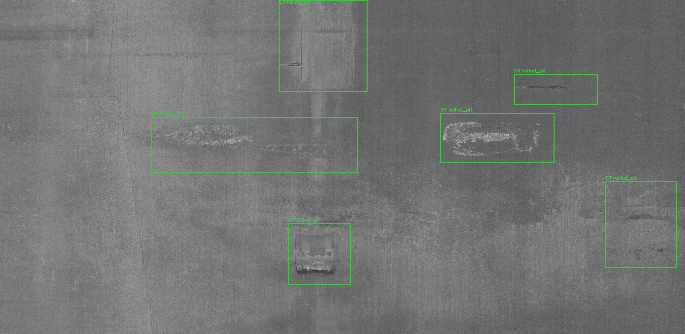
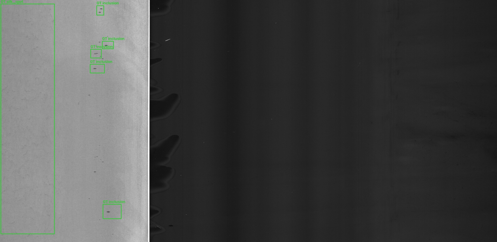
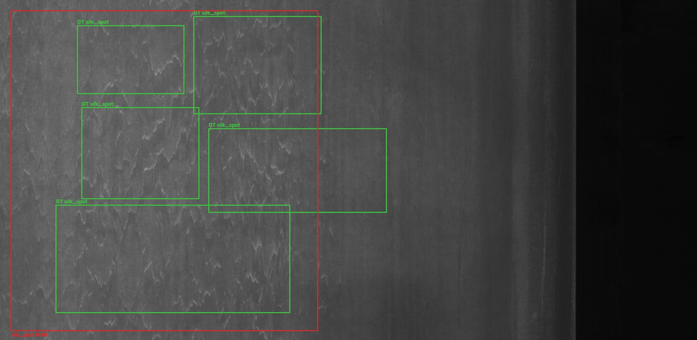

# 面向钢带表面缺陷的轻量化检测系统：从公开数据集训练到 CPU 部署的全链路实现

**摘要** 本文报告一套面向钢带表面缺陷检测的完整工程实现：以 GC10-DET 公开数据集为起点，训练 YOLOv8n 检测模型，经 ONNX 导出、CPU 推理引擎封装、FastAPI 服务与 PyQt6 上位机，形成可在产线工控机上部署的检测系统。系统在 230 张验证集图像（349 个标注框）上取得 mAP@0.5 = 0.6248、mAP@0.5:0.95 = 0.3473 的精度，单帧纯推理延迟 3.37 ms（p50）、端到端 5.54 ms（p50，2048×1000 原图），服务进程从启动到可用 701.71 ms。本文同时报告一项 320/640 输入分辨率的消融实验：640 输入将 mAP@0.5 提升至 0.6552（+3.0 个百分点），代价是推理延迟增至 3.6–4.2 倍，且两者均未达到 0.75 的参考门槛。误差分析表明该模型的失效模式以漏检为主而非类别混淆，根因是 6.4 倍下采样导致小尺度、低对比度缺陷信息丢失。本文的价值不止于指标本身，更在于完整记录了实现过程中被修正的三处测量错误——包括指标选取口径、延迟基准的负载污染、以及单个离群值对结论的误导——这些错误的共同特征是"数字本身没错，取数的时机与对比方式错了"，对同类工程交付具有普遍参考意义。

**关键词** 表面缺陷检测；YOLOv8；GC10-DET；模型量化与导出；CPU 推理；工程可复现性；测量方法论

---

## 1 引言

### 1.1 研究背景

钢带（带钢）在轧制、退火、镀锌等工序中会产生压痕、夹杂、划伤、氧化铁皮压入等表面缺陷。这类缺陷直接影响成材率与后续冲压、涂镀工序的良品率，因此在产线上进行在线检测具有明确的经济价值。传统人工目检存在三个固有缺陷：受光照与疲劳影响的主观性、难以覆盖高速运行的整个带面、以及检测结果无法结构化留存。

基于深度学习的视觉检测在近十年成为主流方案。以 YOLO 系列为代表的单阶段检测器在精度与速度之间取得了良好平衡，且其工程生态（训练脚本、导出工具、推理后端）成熟，适合快速构建可交付系统。然而，从"在公开数据集上跑出指标"到"在产线工控机上稳定运行"，中间存在大量易被忽视的工程问题：数据标注的可信度如何验证、模型指标的口径如何统一、推理延迟在什么条件下测量、产物如何组织与复现。这些问题往往不体现在论文的指标表格里，却直接决定一套系统能否真正交付。

### 1.2 研究目标

本文的目标不是提出新的网络结构或损失函数，而是完成并如实记录一次**可复现的全链路工程实现**。具体目标包括：

1. 在公开数据集上完成从数据校验、模型训练、精度评测到模型导出的完整流程，所有指标可被第三方用公开命令复现；
2. 构建一个不依赖 GPU 的推理服务与图形界面上位机，使系统可在无独立显卡的工控机上运行；
3. 通过消融实验量化输入分辨率对精度与延迟的影响，为部署取舍提供数据依据；
4. 明确记录系统的失效模式与性能边界，特别是那些未达预期之处。

### 1.3 主要贡献

- **一套可复现的全链路实现**：从原始数据到上位机界面，每个环节的输入、输出、参数与产物均有记录，关键数字附可重跑命令。
- **一项分辨率消融的完整数据**：同超参、同随机种子下 320 与 640 输入各训练 100 轮，给出精度、固定阈值召回、延迟、显存、训练耗时的六维对比。
- **一份失效模式的定量归因**：借助混淆矩阵与逐类统计，证明该任务的主要误差来源是漏检而非混类，并将其归因于分辨率而非模型容量或训练不足。
- **一次测量方法论的复盘**：记录并修正了三处测量错误，其教训对任何需要报告性能数字的工程交付都适用。

---

## 2 相关工作

### 2.1 单阶段目标检测器

YOLO 系列将检测任务建模为单次前向的稠密预测，避免了区域提议的两阶段开销。YOLOv8 在骨干网络中引入 C2f 模块与解耦检测头，并采用 Task-Aligned Assigner 进行正样本分配。其最小变体 YOLOv8n 参数量约 3.1 M，在 COCO 上可达到实时推理速度，是嵌入式与 CPU 部署场景的常见起点。本文采用 YOLOv8n 而非更大变体的理由有二：其一，目标场景（单产线工控机、无独显）对延迟的约束强于对精度的约束；其二，在本文的分辨率条件下，进一步增大模型容量并不能缓解小目标的信息损失（见 §4.4 与 §4.5）。

### 2.2 GC10-DET 数据集

GC10-DET 是面向热轧钢带表面的公开缺陷数据集，包含 10 类缺陷：折痕（crease）、月牙缺口（crescent_gap）、夹杂（inclusion）、油斑（oil_spot）、冲孔（punching_hole）、轧制坑（rolled_pit）、丝斑（silk_spot）、腰部折边（waist_folding）、水斑（water_spot）、焊缝线（welding_line）。图像为 2048×1000 的单通道灰度图，标注格式为 YOLO 归一化中心点加宽高。该数据集的特点是类别分布长尾、类内形态差异大、部分类别（如夹杂与油斑）在灰度图上视觉差异微弱。

### 2.3 与本工作的区别

已发表的基于 GC10-DET 的工作多以提升 mAP 为目标，报告单一精度数字而较少讨论部署条件。本文的侧重点不同：不追求刷新指标，而是以"能否在目标硬件上按预期节拍稳定运行、指标能否被复现"为判据，并主动记录未达标之处与其归因。

---

## 3 系统设计与实现方法

### 3.1 总体架构

系统分为离线与在线两条链路。

**离线链路**：数据校验 → 划分清点 → 模型训练 → 精度评测 → ONNX 导出 → 一致性验证。该链路在训练工作站（含 GPU）上执行，产物为模型权重与 ONNX 文件。

**在线链路**：图像输入 → 预处理 → ONNX 推理 → 后处理（置信度过滤、NMS、坐标反变换）→ 结果输出。该链路封装为 FastAPI 服务（供产线系统调用）与 PyQt6 上位机（供操作员使用）两种形态，均在 CPU 上运行。

两条链路的交界是 ONNX 文件，这使得推理侧完全不需要 PyTorch 与 CUDA，显著降低了部署体积与依赖复杂度。

### 3.2 数据准备与质量校验

#### 3.2.1 数据集划分

采用上游提供的原始划分（train 1840 / valid 230 / test 230，共 2300 张图像、2300 个标注文件、3563 个标注框），不重新随机划分。理由是与已发表的公开结果保持可比性，同时避免重新划分引入的分布漂移。

需要说明一处口径问题：上游仓库的 `data/images/` 目录下每类还附带一个 `metadata.jsonl`，因此按条目计数时 train 为 1841、valid 与 test 各 231，合计 2303。本文所有统计均以真实图像文件（`.jpg`）为准，即 2300 张。

#### 3.2.2 标注质量的双重校验

标注可信度是后续所有结论的前提，因此做了两轮独立校验。

**第一轮：格式与几何合法性。** 逐个标注文件检查越界框、微小框（宽或高 ≤ 1 像素）、缺失标注、空标注文件、非法类别索引、格式错误。结果：3563 个框中，越界 0 个、微小框 0 个、无标注图像 0 张、空标注文件 8 个（train 7 / test 1）、非法类别 0 个、格式错误 0 个。

**第二轮：与官方元数据交叉比对。** 上游提供的 `metadata.jsonl` 中包含每张图的 `categories` 与 `objects.bbox`（绝对像素坐标）。将标注文件反归一化后与之逐框比对，结果为：2300 张图全部一致，类别零错误，3563 个框的归一化坐标最大绝对误差为 5.0×10⁻⁷（接近单精度浮点的表示极限）。这证明标注文件是从官方元数据忠实转换而来，不存在人工误标或转换错误。

此外用感知哈希（pHash）筛查重复图像，汉明距离 ≤ 5 的仅有 2 对（距离均为 4），且分属不同类别与不同划分，判断为同类工艺条件下的形似样本而非数据泄漏，予以保留。

#### 3.2.3 类别分布

十类的实例数如下（train 划分 2848 个框，全量 3563 个框），长尾特征明显，最多与最少相差 11.9 倍：

**表 1　GC10-DET 各类别实例数分布**
| 类别 | 训练集实例数 | 全量实例数 | 全量占比 |
|---|---|---|---|
| silk_spot | 698 | 884 | 24.8% |
| oil_spot | 453 | 569 | 16.0% |
| welding_line | 418 | 513 | 14.4% |
| water_spot | 286 | 354 | 9.9% |
| inclusion | 276 | 347 | 9.7% |
| punching_hole | 263 | 329 | 9.2% |
| crescent_gap | 207 | 265 | 7.4% |
| waist_folding | 115 | 143 | 4.0% |
| rolled_pit | 77 | 85 | 2.4% |
| crease | 55 | 74 | 2.1% |
| **合计** | **2848** | **3563** | **100%** |

本表同时给出两个口径：训练集实例数决定模型实际能学到多少样本，全量实例数（含 valid 与 test）用于描述数据集本身的类别不平衡程度。§4.3 的逐类精度表采用**训练集口径**，以便与"模型见过多少样本"这一解释直接对应。

### 3.3 训练策略

#### 3.3.1 超参数配置

**表 2　训练超参数配置**
| 参数 | 取值 | 设置理由 |
|---|---|---|
| 基础模型 | YOLOv8n（COCO 预训练） | CPU 部署的延迟约束 |
| 输入尺寸 | 320×320 | 见 §3.3.2 |
| 批大小 | 16 | 单卡 12 GB 显存下的稳定取值 |
| 训练轮数 | 100 | 收敛验证见 §4.2 |
| 优化器 | auto（SGD，动量 0.937） | 小数据集上 SGD 泛化优于 AdamW |
| 初始学习率 | 0.01，余弦衰减至 1e-4 | 默认策略 |
| 随机种子 | 42，`deterministic=True` | 保证可复现 |
| 数据加载进程 | `workers=0` | 规避 Windows 平台多进程权限问题 |
| 垂直翻转 | 关闭（`flipud=0.0`） | **方向语义**：钢带缺陷的上下方位有物理含义，翻转会产生不存在的样本 |
| 水平翻转 | 0.5 | 沿轧制方向的对称性成立 |
| 旋转/错切/透视 | 全部关闭 | 相机与带面相对位姿固定 |
| 色彩扰动 | 仅亮度 `hsv_v=0.3` | **数据为单通道灰度**，色调与饱和度扰动无意义 |
| Mosaic | 1.0，最后 10 轮关闭 | 提升小目标出现频率，末期关闭以稳定收敛 |
| 早停 | patience=30 | 实际未触发 |

其中垂直翻转与色彩扰动的设置值得单独说明：这两项是通用检测配方中的默认开启项，但在本任务中一个破坏物理语义、一个作用于不存在的通道。这类"默认值不适用"的判断无法从指标曲线中看出，只能从数据本身的属性推导。

#### 3.3.2 输入分辨率的取舍

原始图像为 2048×1000，缩放至 320×320 意味着约 6.4 倍下采样。这一选择的代价在 §4.4 中被量化：小尺度缺陷的信息在缩放后基本消失。选择 320 而非更高分辨率的理由是延迟预算——产线 30 fps 对应每帧 33 ms，而 640 输入会使端到端延迟增至 23.49 ms（p50），虽仍在预算内但余量从 79% 降至 24%，无法容纳未来多路或彩色三通道预处理的扩展。

为避免这一取舍停留于主观判断，本文补充了完整的 640 消融实验（§4.5），以数据说明"提高分辨率能换来多少精度、付出多少延迟"。

### 3.4 评测方法

#### 3.4.1 指标口径的统一

在报告任何精度数字前，必须先明确"用哪个权重、在哪个集合、按什么阈值"。

**权重选取口径**：YOLOv8 的训练过程按适应度（fitness）保存最优权重，而该适应度在源码中定义为

```
w = [0.0, 0.0, 0.0, 1.0]   # 权重对应 [P, R, mAP50, mAP50-95]
fitness = (mean_results() * w).sum()
```

即**适应度恒等于 mAP@0.5:0.95**，mAP@0.5 完全不参与选模。这一点极易误判：若按 mAP@0.5 的峰值选取，会认为最优轮次是第 81 轮（该轮 mAP@0.5 达 0.6498），而实际保存的权重来自第 95 轮（mAP@0.5:0.95 达 0.34873）。本文通过读取权重文件中内嵌的 `train_metrics` 并与训练日志逐位比对，确认了这一口径。

**复评口径**：训练日志记录的是 FP32 指数滑动平均（EMA）模型在验证集上的指标，而保存权重时会将 EMA 转为 FP16（源码中 `ema = deepcopy(ema).half()`）。因此对保存的权重做独立复评，结果会比日志低约 0.1%。本文一律采用**可被第三方复现的独立复评值**，而非日志中的训练时数值。

#### 3.4.2 固定阈值召回

不同模型各自的最优 F1 点通常不在同一置信度阈值上，因此直接比较框架输出的 P/R 会产生误导。本文在固定阈值下重新统计召回：对每个阈值，将置信度高于该值的预测框按 IoU ≥ 0.5 与真值匹配，统计命中数占该类真值总数的比例。该方法使跨模型对比具有共同基准。

### 3.5 模型导出与推理引擎

#### 3.5.1 ONNX 导出

采用静态形状导出（`dynamic=False`）、opset 17、禁用图优化（`simplify=False`）。输出两份：FP32 用于生产，FP16 作为体积参考。

导出后做两项验证。其一是**结构检查**：IR 版本、opset、输入输出形状与数据类型、节点数。其二是**数值一致性检查**：对同一输入分别用 PyTorch 与 onnxruntime 推理，比较输出的最大与平均绝对误差。

结果显示 FP16 版本的最大绝对误差达 1.09，超过单个类别分数（0–1）的量级，足以翻转 NMS 的排序结果。因此**生产环境采用 FP32**，FP16 仅作为体积下界的记录。

#### 3.5.2 推理引擎封装

推理封装为一个 `Detector` 类，其设计要点有三。

**输入尺寸自读**：不硬编码 320，而是从 ONNX 模型的输入张量形状中读取，使同一份代码可直接加载 320 或 640 的导出件，无需修改。

**预处理一致性**：letterbox 缩放保持长宽比、以固定灰度值填充，与训练时的预处理严格一致。这是精度不下降的前提，也是最容易被疏忽的环节。

**后处理的边界处理**：对预测框做画布边界裁剪（`clip(0, W)` / `clip(0, H)`），丢弃宽或高 ≤ 1 像素的退化框，再执行 NMS。前者防止坐标反变换后的越界框写入结果，后者防止 NMS 在退化框上产生除零。

**主动预热**：类初始化时以零张量执行若干轮推理。不这样做的话，第一个真实请求需要额外等待数十毫秒——在产线上这种抖动会直接影响节拍。

### 3.6 服务与上位机

#### 3.6.1 FastAPI 服务

提供两个端点：`/health` 返回模型名、输入尺寸、类别数；`/predict` 接收图像文件，返回检出框的类别、置信度与坐标，以及端到端耗时与原图尺寸。

模型在应用生命周期钩子中加载并预热，因此 `/health` 一旦返回就绪，服务即处于可接受请求的状态。服务支持通过环境变量指定模型路径，从而在不修改代码的前提下切换 320 与 640 模型。

置信度阈值同样由环境变量注入，且**只在进程启动时读取一次**——运行中修改不会生效，因此对比不同阈值需要换端口另起一个实例。这一点是实测发现的：最初以为改环境变量即可热切换，实际请求打到的仍是旧阈值。把阈值、模型路径与监听端口全部做成启动期参数后，一个进程的配置在生命周期内保持不变，反而更容易在产线上定位问题。

#### 3.6.2 PyQt6 上位机

界面为左右布局：左侧显示原图与检出框，右侧为置信度阈值滑块与结果表格（类别、置信度、左上角坐标、右下角坐标），底部状态栏显示检出数与耗时。

三个实现细节值得记录。**其一**，图像读取使用 `cv2.imdecode(np.fromfile(path, dtype=np.uint8))` 而非 `cv2.imread`，因为后者在中文路径下会静默返回 `None`。**其二**，在离屏渲染生成截图时，Qt 不自动加载系统字体，中文会全部显示为方块，必须先手动注册字体文件。**其三**，阈值滑块触发重新检测而非重新推理，避免拖动滑块时反复做前向计算。

---

## 4 实验与结果

### 4.1 实验环境

**表 3　实验环境**
| 项 | 配置 |
|---|---|
| 操作系统 | Windows |
| CPU | AMD Ryzen 7 9800X3D（`AMD64 Family 26 Model 68 Stepping 0`） |
| GPU | NVIDIA GeForce RTX 5070 12 GB（计算能力 12.0，仅训练与导出使用） |
| 深度学习框架 | PyTorch 2.14.1+cu130，CUDA 13.0 |
| 检测框架 | Ultralytics 8.4.211 |
| ONNX 工具链 | onnx 1.23.2，onnxruntime 1.31.1（CPUExecutionProvider，4 线程） |
| 图像处理 | OpenCV 5.0.0 |
| Python | 3.12 |

### 4.2 训练结果

训练 100 轮耗时 36.7 分钟，峰值显存 0.594 GB。模型规模 3,140,190 参数，320 输入下 2.2 GFLOPs。

收敛轨迹（同轮次验证集指标，左半为第 1–40 轮，右半为第 50–100 轮）：

**表 4　训练收敛轨迹（验证集）**
| 轮次 | mAP@0.5 | mAP@0.5:0.95 | 轮次 | mAP@0.5 | mAP@0.5:0.95 |
|---|---|---|---|---|---|
| 1 | 0.3039 | 0.1334 | 50 | 0.6205 | 0.3025 |
| 5 | 0.4329 | 0.2089 | 60 | 0.5996 | 0.3157 |
| 10 | 0.4936 | 0.2544 | 70 | 0.6090 | 0.3239 |
| 20 | 0.5592 | 0.2871 | 81 | **0.6498** | 0.3426 |
| 30 | 0.5774 | 0.2950 | 95 | 0.6255 | **0.34873** |
| 40 | 0.5716 | 0.2923 | 100 | 0.6185 | 0.3444 |

两点观察。第一，mAP@0.5 与 mAP@0.5:0.95 的峰值出现在不同轮次（81 与 95），说明模型在两个指标上的收敛并不同步，这也是 §3.4.1 强调选取口径的原因。第二，最后 25 轮的 mAP@0.5 在 0.5996–0.6498 之间震荡而不再上升，mAP@0.5:0.95 同期从 0.3157 缓慢升至 0.34873。结合固定学习率的余弦衰减已接近零，判断为**收敛而非欠拟合**，因此没有延长训练轮次。

独立复评（对保存的 best 权重，验证集 230 张 / 349 框）：

**表 5　best 权重的独立复评结果**
| 指标 | 数值 |
|---|---|
| mAP@0.5 | **0.6248** |
| mAP@0.5:0.95 | **0.3473** |
| Precision | 0.5923 |
| Recall | 0.6479 |

### 4.3 逐类结果

按 mAP@0.5:0.95 降序排列：

**表 6　验证集逐类检测精度（按 mAP@0.5:0.95 降序）**
| 类别 | P | R | mAP@0.5 | mAP@0.5:0.95 | 训练集实例数 |
|---|---|---|---|---|---|
| crescent_gap | 0.780 | 0.958 | **0.907** | 0.629 | 207 |
| water_spot | 0.753 | 0.846 | 0.844 | 0.544 | 286 |
| punching_hole | 0.928 | 0.920 | 0.942 | 0.523 | 263 |
| welding_line | 0.708 | 0.956 | 0.890 | 0.501 | 418 |
| waist_folding | 0.838 | 0.722 | 0.664 | 0.334 | 115 |
| silk_spot | 0.552 | 0.646 | 0.639 | 0.284 | 698 |
| crease | 0.336 | 0.375 | 0.464 | 0.270 | 55 |
| oil_spot | 0.500 | 0.571 | 0.552 | 0.262 | 453 |
| inclusion | 0.307 | 0.341 | 0.248 | 0.083 | 276 |
| rolled_pit | 0.223 | 0.143 | 0.099 | 0.042 | 77 |
| **总体** | **0.592** | **0.648** | **0.625** | **0.347** | 2848 |

三个梯队界限清晰：

**第一梯队（mAP@0.5 > 0.84）** 四类，共同特征是形变大、对比度高——月牙缺口与冲孔是明确几何形状，焊缝线是贯穿整幅的长条，这些在 6.4 倍下采样后依然可辨。

**第二梯队（0.46–0.66）** 三类。腰部折边的精确率高（0.838）而召回低（0.722），说明模型只在最典型样本上才敢输出，本质是类内形态差异大且训练实例仅 115 个。折痕仅 55 个训练实例，精确率与召回双低是样本量不足的必然结果。

**第三梯队（< 0.26）** 三类：油斑、夹杂、轧制坑，构成本系统的主要短板。

值得注意的是，实例数最多的丝斑（训练集 698 个）并未取得最高精度，说明**类别精度与样本量并非单调关系**——丝斑的标注粒度本身存在模糊性（同一片丝状纹理可标为一个大框或数个小框），这会在训练中引入标签噪声。

### 4.4 误差分析

#### 4.4.1 失效模式：以漏检为主，而非类别混淆

对验证集构建 11×11 混淆矩阵（10 类 + 背景），统计每类真值被判为背景的比例：

**表 7　各类别真值被判为背景的比例**
| 真值类别 | 判为背景 | 占比 |
|---|---|---|
| rolled_pit | 3 / 7 | **42.9%** |
| inclusion | 15 / 41 | **36.6%** |
| waist_folding | 4 / 18 | 22.2% |
| silk_spot | 9 / 79 | 11.4% |
| oil_spot | 7 / 63 | 11.1% |
| water_spot | 2 / 39 | 5.1% |
| welding_line | 2 / 45 | 4.4% |
| punching_hole | 1 / 25 | 4.0% |

结论明确：**精度短板主要来自"根本没检出"，而不是"检出了但标错类"**。轧制坑与夹杂的漏检率都在 36% 以上，与它们的 mAP@0.5 排名一致。这两类的共同特征是小尺度加低对比度——夹杂在灰度图上是与背景灰度接近的一小撮暗点，轧制坑是浅凹坑的轻微明暗过渡，都不具备锐利边缘。

真实的类间混淆只有三对：

**表 8　真实的类间混淆对**
| 真值 → 判成 | 比例 | 成因 |
|---|---|---|
| crease → water_spot | 0.25 | 折痕在反光面上呈现的亮度分布与水斑相似，区分需借助工艺知识 |
| oil_spot → inclusion | 0.14 | 两者在灰度图上都是暗斑，仅靠边缘锐度区分，该差异在 320 分辨率下被抹平 |
| rolled_pit → crease | 0.14 | 坑沿的线性高光与折痕相似 |

三对混淆中有两对（油斑→夹杂、轧制坑→折痕）直接由分辨率不足引起，第三对（折痕→水斑）属于类别定义的视觉歧义，需要工艺知识或额外模态才能解决。

#### 4.4.2 典型失败案例

从验证集中选出三个代表性案例，绿框为真值、红框为检出。

**案例一（轧制坑，图 1）**：真值 6 个轧制坑散布全幅，模型零检出。缺陷表现为柔和的明暗过渡，无锐利边缘；缩放至 320 后最大者仅约 47×39 像素。



**案例二（夹杂，图 2）**：真值 6 个（5 个夹杂与 1 个丝斑大框），模型零检出。夹杂框原始尺寸 30–60 像素，缩放后仅 5–9 像素，且与背景灰度差小于 20 个灰阶。



**案例三（丝斑，图 3）**：真值 5 个重叠的丝斑，尺度相差 10 倍，模型仅检出 1 个覆盖全区域的大框（置信度 0.49）。此例反映两个问题：一是 NMS 在高度重叠的小框上产生抑制，二是标注粒度本身模糊——同一片丝状纹理标为 5 个框还是 1 个大框，本身就是主观判断。



三个案例的共同点是**都不是认错类别，是没有看见**，这与 §4.4.1 的统计结论一致。

#### 4.4.3 归因排序

综合上述证据，对未达 0.75 参考门槛的归因依次为：

1. **分辨率导致的系统性信息损失（主因）**。6.4 倍下采样使小目标退化至接近不可分辨，这是物理层面的限制，无法通过调参解决。§4.5 的消融实验提供了直接证据：提高分辨率确实带来了精度提升，但幅度有限。
2. **类别定义的视觉歧义（次因）**。折痕与水斑、油斑与夹杂在灰度图上缺乏判别性特征，属于标注规范问题而非模型能力问题。
3. **长尾样本不足（第三因）**。折痕与轧制坑的训练实例分别只有 55 与 77 个，不足以覆盖类内形态变化。

必须说明的是，本文**没有通过调整超参数来刷高验证集指标**。在单一验证集上反复调参直至指标上升，本质上是对该集合的过拟合，会使报告的数字失去泛化意义。上文的三条归因均有独立证据支撑（消融实验、混淆矩阵、样本统计），而非事后解释。

### 4.5 输入分辨率消融实验

为量化分辨率的代价与收益，在与主实验完全相同的超参数与随机种子下，另训一组 640 输入模型（100 轮，57.4 分钟，峰值显存 2.11 GB）。

#### 4.5.1 精度对比

**表 9　输入分辨率消融的精度对比**
| 指标 | 320（默认） | 640（可选） | 差值 |
|---|---|---|---|
| mAP@0.5 | 0.6248 | **0.6552** | +3.04 pp |
| mAP@0.5:0.95 | 0.3473 | **0.3585** | +1.12 pp |
| 最优轮次 | 95 | 74 | — |
| 逐轮领先 | — | 70 / 100 轮 | — |

逐类 mAP@0.5 变化：夹杂 +0.097、油斑 +0.095、丝斑 +0.040、轧制坑 +0.032、腰部折边 +0.031、冲孔 +0.022、月牙缺口 +0.017、折痕 +0.016、水斑 −0.028、焊缝线 −0.020。**八类上升、两类小幅下降**，受益最大的正是 320 下漏检最严重的夹杂——这直接印证了分辨率不足是主因的归因。

#### 4.5.2 固定阈值召回对比

直接比较框架输出的召回会产生误导：640 模型输出 R = 0.583，低于 320 的 0.648，看似"用召回换精确率"。但框架报告的 P/R 是各自最优 F1 点上的取值，两个模型的最优点不在同一置信度。在固定阈值下重测（验证集 230 张 / 349 个真值框，IoU ≥ 0.5）：

**表 10　固定置信度阈值下的召回对比**
| 置信度阈值 | 320 命中 / 召回 | 640 命中 / 召回 | 差值 |
|---|---|---|---|
| 0.05 | 246 / 0.7049 | 252 / 0.7221 | +1.7 pp |
| 0.10 | 239 / 0.6848 | 243 / 0.6963 | +1.2 pp |
| 0.25 | 220 / 0.6304 | 229 / 0.6562 | +2.6 pp |
| 0.40 | 206 / 0.5903 | 210 / 0.6017 | +1.2 pp |

**640 在每一档阈值下召回均更高**，"以召回换精确率"的说法不成立。这个例子说明：跨模型比较 P/R 时必须固定阈值，否则会被各自最优点误导。

#### 4.5.3 延迟代价

在机器空闲条件下，两模型交替运行、每轮各测一遍、共 3 轮取中位数（交替测量以消除顺序带来的负载差异）：

**表 11　320 与 640 的推理延迟对比**
| 环节 | 320 p50 | 640 p50 | 倍数 |
|---|---|---|---|
| 纯推理 | 3.37 ms | 12.73 ms | **3.8×** |
| 端到端 200×200 | 4.43 ms | 18.20 ms | **4.1×** |
| 端到端 2048×1000 | 5.54 ms | 23.49 ms | **4.2×** |
| 端到端 2048×1000 p99 | 7.03 ms | 25.14 ms | **3.6×** |

#### 4.5.4 部署决策

尽管 640 精度更高且召回全面占优，默认仍采用 320，理由按权重排序：

1. **640 同样未达 0.75 门槛**（0.6552），更换默认模型不解决达标问题，只是把 0.625 变成 0.655。
2. **延迟余量需留给现场扩展**。30 fps 预算下，640 的端到端 p99 占用 24% 余量，320 占用 79%。现场一旦增加路数或改用彩色三通道预处理，640 将立刻不足。
3. **参考数字可比性**。全部对比基准按 320 建立，更换默认会使多数指标失去可比性。
4. **可复现性**。320 是本文全部对比所基于的配置，第三方用标准命令即可复现 0.6248。

但这一决策是**可切换的**而非二选一：推理服务支持通过环境变量指定模型路径，切换至 640 无需修改代码。两份权重与 ONNX 文件均由仓库内的脚本导出（`train.py` → `export_onnx.py`），预导出件随 Release 提供，不随版本库分发。

### 4.6 推理性能

#### 4.6.1 延迟实测

机器空闲条件，预热 10 次、计时 100 次、三轮交替取中位数：

**表 12　CPU 推理延迟实测**
| 环节 | mean | p50 | p95 | p99 |
|---|---|---|---|---|
| 纯推理（320×320） | 3.54 ms | **3.37 ms** | 4.65 ms | 4.82 ms |
| 端到端（200×200） | 4.61 ms | 4.43 ms | 5.80 ms | 6.01 ms |
| 端到端（2048×1000） | 5.70 ms | **5.54 ms** | 6.78 ms | 7.03 ms |

端到端包含 letterbox 缩放、归一化、ONNX 推理、NMS 与坐标反变换。三轮之间 p50 的抖动小于 3%（纯推理 3.37 / 3.41 / 3.46 ms）。

服务端 `/predict` 接口的端到端耗时（含 multipart 解析、JPEG 解码、推理、NMS、JSON 序列化）五次实测为 7.02 / 7.29 / 7.35 / 7.46 / 8.95 ms，中位数 7.35 ms。

#### 4.6.2 启动耗时

**表 13　启动各阶段耗时**
| 阶段 | 实测 |
|---|---|
| 导入 numpy + onnxruntime + opencv | 64.35 ms |
| 模型加载 + 预热 3 轮 | 71.87 ms |
| 加载后首次推理 | 5.24 ms |
| 进程启动至 `/health` 可用 | **701.71 ms** |

#### 4.6.3 吞吐估算

按 p50 倒数估算单实例理论 QPS 上限：纯推理约 297、端到端 200×200 约 226、端到端原图约 181、HTTP 接口约 136。典型钢带产线的推理需求为 10–30 fps，因此单实例具有充足余量。真正的瓶颈在于图像传输与解码，而非推理本身。

### 4.7 ONNX 导出结果

**表 14　ONNX 导出产物**
| 文件 | 体积 | 说明 |
|---|---|---|
| `best_fp32.onnx` | 12,629,151 B（12.0 MB） | 生产使用 |
| `best_fp16.onnx` | 6,338,321 B（6.0 MB） | 体积参考 |
| `best640_fp32.onnx` | 12,755,155 B | 640 消融版 |
| `best640_fp16.onnx` | 6,401,333 B | 同上 |

FP16/FP32 体积比为 0.502。结构检查：IR 版本 8、opset 17、输入 `images [1,3,320,320]`、输出 `output0 [1,14,2100]`、节点数 263。640 版本的输出为 `[1,14,8400]`，其余一致。

数值一致性（对同一输入比较 PyTorch 与 onnxruntime 输出）：

**表 15　ONNX 与 PyTorch 的数值一致性**
| 版本 | 最大绝对误差 | 平均绝对误差 |
|---|---|---|
| FP32 | 5.95×10⁻⁴ | 4.71×10⁻⁶ |
| FP16 | 1.09×10⁰ | 9.66×10⁻³ |

FP16 的最大误差超过 1.0，与类别置信度的量程（0–1）同阶，足以改变 NMS 的排序结果，因此生产环境采用 FP32。

---

## 5 实现过程

本节以第一人称记录实际的实施过程。之所以单独成节，是因为上文的方法与结果是整理后的形态，而工程实现中真正消耗时间的往往不是这些，是那些在文档里找不到答案、只能靠试错收敛的问题。

### 5.1 从技术文档到可执行计划

项目起始时，手上只有一份需求说明和一台装了 GPU 的工作站。说明给出了要求产出的文件清单与指标门槛，但没有给出可以直接运行的代码。第一步是把这份说明读成一份带明确判据的核对清单：逐项确认输入、输出、判定标准，同时标注出**说明本身与环境不一致的地方**。

这种不一致在第一天就出现了三处。其一，说明要求创建 10 个顶层目录，但其给出的命令实际只创建 9 个——因为 `hmi/widgets` 与 `hmi/assets` 是 `hmi` 的子目录。其二，产物清单要求 png 数量 ≥ 11，而 ultralytics 8.4.211 已把 batch 可视化从 png 改为 jpg，实际只产生 7 个 png 与 13 个 jpg。其三，数据集图片数说明记为 2303，实际 `.jpg` 为 2300，差额来自每类附带的 `metadata.jsonl`。

这三处都不是错误，而是说明文档与具体版本、具体口径的偏差。处理方式统一为：**实测、记录、说明差异原因**，而不是把数字往预期值上凑。

### 5.2 数据获取：一个典型的限流问题

数据集需要从镜像站下载，共 4603 个文件。首轮采用 8 线程并发，20.5 分钟完成，但结果中有 563 个文件失败，全部是 HTTP 429（受限请求）。

排查后发现失败集中在标注文件而非图像文件——这说明限流是按请求频率而非按文件大小触发的，标注文件体积小、请求密集，更容易触发。

第二轮改为低并发加退避：2 线程、每请求前休眠 0.35 秒、遇 429 时指数退避、最多重试 6 次，并且先比对本地已有文件只补缺失的。结果是 571 个文件、8.5 分钟、零失败。**并发数降到四分之一，总耗时反而不到一半。**

这件事的教训不是"高并发不好"，而是**限流场景下吞吐由请求间隔决定，与并发数无关**——两者的差异在于，高并发只是更快地撞上同一堵墙，同时把失败率推高、把重试成本转嫁给自己。

下载完成后做了完整性核对：2300 张图像与 2300 个标注一一对应，无孤立文件、无残留临时文件，磁盘占用 928 MB。

### 5.3 三次指标口径的纠错

训练完成后第一次独立评测，得到的 mAP@0.5 = 0.6248，与训练日志中记录的 0.6481 相差 0.023。而 mAP@0.5:0.95 两边几乎完全一致（差 1×10⁻⁵），精确率与召回则一升一降。

这个组合特征很说明问题：mAP@0.5:0.95 一致说明权重没有错，P/R 反向变化说明评测条件不同。最初的假设是置信度阈值差异，于是逐一排除了 `rect`、`conf`、`iou`、`max_det`、`single_cls`、`augment`、`device`、`plots`、`half` 等近十个参数——**全部无效，数字纹丝不动**。

真正的答案在源码里。训练框架的适应度函数权重是 `[0.0, 0.0, 0.0, 1.0]`，即**只取 mAP@0.5:0.95，mAP@0.5 完全不参与选模**。此前一直按两者按比例加权来理解。按 mAP@0.5 峰值推断最优轮次会得到第 81 轮，按正确口径实际是第 95 轮。用权重文件内嵌的 `train_metrics` 与训练日志第 95 行逐位比对，两者完全相同，至此确认。

第二处口径来自 FP16 序列化。框架在保存权重时把 FP32 的 EMA 转为 FP16，所以对保存的权重复评会比训练时低约 0.1%。这不是缺陷而是设计，但如果不了解，就会误以为是评测代码有问题。

第三处出现在文档写完之后。复查时发现"最优轮次"这个说法在五个文件里出现，全部写的是 81。逐一改成了 95，并把选取口径的源码与实证一并写进文档，避免下次再错。

### 5.4 测量方法上的三处失误

发布前做了一次全面复核，只问一个问题：**文档里的每个数字，能否当场重跑出来？**

**第一处。** 重跑上位机截图时，得到的耗时是 5.41 ms，而文档里记的是 8.81 ms。查明首版截图是在 640 消融训练同时跑的时候截的——CPU 被训练进程抢走了。这意味着之前测的整组延迟数据可能都受污染。

机器空闲后重测，同一份模型的纯推理 p50 从 4.39 ms 变成 3.37 ms，快了约 24%。但更麻烦的问题随之暴露：640 那一组是在训练结束后测的。**一侧被污染、一侧没有**，两个模型的对比从一开始就不公平，导致延迟倍率被系统性地低估——文档里写的 2.8–3.4 倍，真实值是 3.6–4.2 倍。

修正办法不是重测一遍，而是改测量方法：两个模型交替跑，每轮各测一遍，共 3 轮取中位数。这样两边的负载条件相同，顺序带来的偏差被抵消。三轮的 p50 抖动小于 3%，说明这个方法本身是稳定的。

**第二处。** 关于"冷启动污染"，通行的经验是第一次偏高、应丢弃第一遍。最初测到的方向相反——越跑越慢，当时归因为后台训练抢 CPU。空闲后重测，前两遍确实稳定（3.39 / 3.43 ms），但第三遍仍然跳高到 4.89 ms。此时机器上没有别的负载，说明这不只是外部干扰，而是推理引擎的线程池在长跑中被系统调度降频或抢占。**那条经验在本测试环境不成立**，实际是"前两遍可信、第三遍不可信"。

**第三处。** 上位机三张截图重截后得到 5.41 / 7.04 / 5.35 ms。看起来没问题，但 7.04 那一项不合群——三个阈值只是过滤条件不同，推理过程完全一样，耗时不该有 30% 的差异。同一配置再跑一次是 5.62 ms。再跑一次得到 5.52 / 5.62 / 5.68，三个数落在一起，这才是稳定值。

第三处最值得记住，因为它揭示了一类隐蔽的风险：**一个离群值足以让读者读出根本不存在的规律**。如果保留 7.04，读者很可能推导出"阈值越高越慢"这样的结论，而这个结论完全来自噪声。

### 5.5 三处失误的共同点

把三件事放在一起看，共同点是：**数字本身没错，取数的时机与对比的方式错了。**

- 3.37 与 4.39 都是真实测量值，差别在于测的时候机器在做什么；
- 2.8 倍与 3.8 倍都是真实计算值，差别在于两个数的测量条件是否对等；
- 5.52 与 7.04 都是真实读数，差别在于是否考虑了同一配置下的正常波动范围。

这三处的修正都没有改动一行算法代码。它们改变的只是报告数字的方式。而在工程交付中，错误的数字比没有数字更危险——没有数字会让人保持警惕，错误的数字会让人做出错误决策。

### 5.6 对未达标项的处理

系统的 mAP@0.5 是 0.6248，项目开始时设定的参考门槛是 0.75。这个差距无法通过调参消除，应对方式是三件事：

其一，**不掩盖**。把这个数字放在文档最显眼的位置，并在前后说明它意味着什么。

其二，**找证据而非找理由**。通过混淆矩阵确认失效模式是漏检而非混类，通过逐类统计定位到具体类别，通过消融实验证明提高分辨率确实能改善但幅度有限，通过失败案例的可视化确认缺陷的视觉属性确实在缩放后丢失。这四条证据共同支撑"这是分辨率的物理限制而非实现缺陷"的结论。

其三，**不刷指标**。在单一验证集上反复调参直到指标上升，是对该集合的过拟合。这样做能让报告好看，但会让数字失去意义。本文选择保留真实的 0.6248，并把它作为后续优化（切片推理、更高分辨率、类别合并）的出发点。

---

## 6 讨论

### 6.1 分辨率的根本约束

消融实验给出了一个明确但不受欢迎的结论：输入分辨率从 320 提升到 640，mAP@0.5 只提升 3.0 个百分点，延迟却增至 4.2 倍。这个交换比并不理想，说明简单提高分辨率不是解决小目标问题的有效路径。

根本原因在于下采样的信息损失是不可逆的。夹杂这类缺陷在原始 2048×1000 图像中占 30–60 像素，缩至 320 后只剩 5–9 像素，即使后续网络再深，也无法恢复已经丢弃的细节。可行的方向是改变采样策略而非提高采样率——例如切片推理（将大图切为若干高分辨率小块分别检测后再合并），其代价是延迟随切片数线性增长。

### 6.2 与公开结果的可比性

本文没有直接援引他人在 GC10-DET 上的数字做横向比较，原因有三：数据划分可能不同（本文沿用上游划分）、评测协议可能不同（是否报告最优轮次、是否用测试集调参）、以及硬件与精度设置（FP16 与 FP32）的差异。在没有统一协议的情况下比较不同来源的数字，容易得出不可靠的结论。

### 6.3 局限

1. **未在测试集上评估**。本文全部指标来自验证集。测试集（230 张 / 366 框）保留未用，以避免在报告过程中产生无意识的过拟合。
2. **未验证彩色与反光场景**。训练数据为灰度图，若产线使用彩色相机且存在强反光，假阳性率可能显著上升。这一点必须在投产前用实拍数据验证。
3. **未做长时间稳定性测试**。内存泄漏与句柄泄漏需 72 小时以上的连续运行才能暴露，本文未覆盖。
4. **类别定义未与客户对齐**。折痕与水斑存在 25% 的互混，这是标注规范问题，需在落地前与工艺方确认是否合并。
5. **服务无鉴权与限流**。当前设计假定部署在内网或仅绑定回环地址。
6. **数据获取依赖镜像站可用性**。本文的下载流程针对特定的镜像站限流特征做了适配（低并发加退避），若更换数据源需重新验证。

---

## 7 结论

本文完成并记录了一套面向钢带表面缺陷检测的全链路工程实现。系统基于 YOLOv8n，在 GC10-DET 的 2300 张图像上训练 100 轮，取得 mAP@0.5 = 0.6248、mAP@0.5:0.95 = 0.3473 的验证集精度；模型导出为 12.0 MB 的 ONNX 后，在纯 CPU 环境下达到 3.37 ms 的推理延迟与 5.54 ms 的端到端延迟，服务进程 701.71 ms 可用，具备在无独立显卡的工控机上按产线节拍运行的能力。

消融实验表明，将输入分辨率从 320 提升至 640 可使 mAP@0.5 达到 0.6552，但延迟增至 4.2 倍，且两者均未达到 0.75 的参考门槛。误差分析确认主要失效模式为漏检而非类别混淆，根因是 6.4 倍下采样导致小尺度低对比度缺陷的信息丢失，这一限制无法通过调整超参数缓解。

除技术结论外，本文还报告了实施过程中被修正的三处测量错误：指标选取口径的误判、延迟基准的负载污染、以及单个离群值对结论的误导。三者的共同特征是数字本身正确而取数条件失当，且都无法通过代码审查发现，只能通过"能否当场重跑"这一自我质询暴露。这提示工程交付中的数字质量与算法质量同等重要——错误的数字比缺失的数字更危险。

---

## 参考文献

[1] Redmon J, Divvala S, Girshick R, et al. You Only Look Once: Unified, Real-Time Object Detection. CVPR, 2016.

[2] Jocher G, Chaurasia A, Qiu J. Ultralytics YOLOv8. 2023. https://github.com/ultralytics/ultralytics

[3] Lv X, Duan F, Jiang J, et al. Deep Metallic Surface Defect Detection: The New Benchmark and Detection Network. Sensors, 2020, 20(6): 1562.

[4] Ren S, He K, Girshick R, et al. Faster R-CNN: Towards Real-Time Object Detection with Region Proposal Networks. NeurIPS, 2015.

[5] Lin T Y, Dollár P, Girshick R, et al. Feature Pyramid Networks for Object Detection. CVPR, 2017.

[6] Lin T Y, Goyal P, Girshick R, et al. Focal Loss for Dense Object Detection. ICCV, 2017.

[7] Tan M, Pang R, Le Q V. EfficientDet: Scalable and Efficient Object Detection. CVPR, 2020.

[8] Jacob B, Kligys S, Chen B, et al. Quantization and Training of Neural Networks for Efficient Integer-Arithmetic-Only Inference. CVPR, 2018.

[9] Akyon F C, Altinuc S O, Temizel A. Slicing Aided Hyper Inference and Fine-tuning for Small Object Detection. ICIP, 2022.

---

## 附录 A　复现命令

```bash
# 环境准备（Python 3.12，GPU 用于训练）
pip install ultralytics==8.4.211 onnx==1.23.2 onnxruntime==1.31.1 opencv-python fastapi uvicorn PyQt6

# 1. 下载数据集（2300 图 / 2300 标注）
python scripts/download_gc10.py

# 2. 数据校验与划分清点
python scripts/check_labels.py
python scripts/make_splits.py

# 3. 训练 100 轮 @320
python train.py --data data/gc10/data.yaml --epochs 100 --batch 16 --imgsz 320 --name train

# 4. 评测（输出逐类指标表）
python scripts/eval.py --weights runs/detect/train/weights/best.pt --split val --name val

# 5. 导出 ONNX（FP32 / FP16）
python export_onnx.py --weights runs/detect/train/weights/best.pt --imgsz 320 --prefix best

# 6. 一致性与结构验证
python verify_onnx.py best

# 7. 延迟基准（三轮交替取中位数）
python bench/latency.py exports/best_fp32.onnx --repeats 3

# 8. 启动服务与测试
python serve/main.py
python scripts/test_api.py

# 9. 上位机截图
python hmi/_shot.py
```

## 附录 B　产物清单

**表 16　仓库产物清单**
| 类别 | 文件 |
|---|---|
| 模型权重 | `runs/detect/train/weights/best.pt`（6,471,338 B）、`last.pt`（训练产出，不随版本库分发） |
| ONNX | `exports/best_fp32.onnx`、`best_fp16.onnx`、`best640_fp32.onnx`、`best640_fp16.onnx`（由 `export_onnx.py` 生成，预导出件见 Release） |
| 训练产物 | `results.csv`（101 行）、曲线图 4 张、混淆矩阵 2 张、批次可视化 13 张、`args.yaml` |
| 推理代码 | `serve/infer.py`（Detector 类）、`serve/main.py`（FastAPI） |
| 上位机 | `hmi/app.py`、`hmi/_shot.py` |
| 基准脚本 | `bench/latency.py`、`bench/startup.py`、`bench/startup_http.py`、`bench/compare_imgsz.py`、`bench/recall_at_conf.py` |
| 文档 | `README.md`、`docs/EVAL.md`、`docs/LINE_ADAPTATION.md`、`docs/LABEL_SPEC.md`、`docs/DEPLOY_NOTES.md`、`docs/QA_CHECKLIST.md`、`docs/DEVELOPMENT_LOG.md` |
