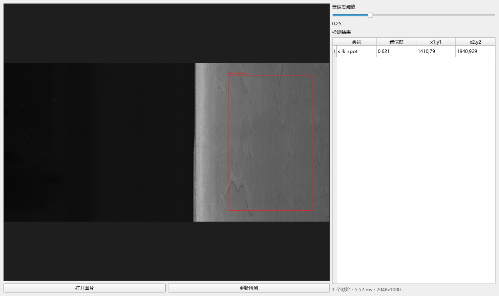

# 实操验证指南 · Hands-On Verification

> **这份文档回答什么问题**：克隆仓库之后，怎么一步步验证训练、导出、推理、服务、上位机各环节确实能跑通，以及每一步的预期输出是什么。
>
> 全文按「你能验证什么」组织，每条都给**预期输出**和**这个输出说明了什么**。所有数字取自本测试环境的实测结果，硬件与依赖版本如下。

参考环境：Python 3.x、torch 2.14.1+cu130、ultralytics 8.4.211、onnx 1.23.2、onnxruntime 1.31.1、opencv 5.0.0、PyQt6。参考硬件：训练用 GPU RTX 5070 12GB，CPU 推理用 AMD Ryzen 7 9800X3D（4 线程）。

**命令约定**：下文所有命令都在**仓库根目录**执行，路径一律相对路径；shell 语法按 Git Bash 给出。`VAR=value python ...` 这种前置环境变量的写法在 PowerShell 里要拆成两步：先 `$env:VAR="value"`，再单独执行命令。

建议在虚拟环境里装依赖，避免污染系统 Python：

```bash
python -m venv .venv
```

```powershell
.venv\Scripts\activate
pip install -r requirements.txt        # 推理 / 服务 / 上位机
pip install -r requirements-dev.txt    # 训练与评测（torch + ultralytics，可选）
```

下文出现的 `python` 都指这个已经装好依赖的解释器。推理服务默认在 `http://127.0.0.1:8000` 上提供接口；如果它没在跑，按 §2.1 启动。

---

## 1 Quick Checks · 三个 30 秒检查

先做这三条。它们都不需要 GPU、不需要重训，回答的是同一个问题：磁盘上的权重和日志是不是真的，模型是不是真的在做推理。

### 1.1 权重文件是真的

不是空文件，也不是从别处随意复制的同名文件。

> **`exports/` 下的 ONNX 不在仓库里**，需要先按 README §3.4 从 Release 下载、或自己跑 `python export_onnx.py` 导出。下面这两条命令的前提是文件已经在位；如果 `exports/` 是空的，先做 `ls -l runs/detect/train/weights/*.pt` 这一半。

```bash
ls -l --time-style=long-iso runs/detect/train/weights/*.pt exports/*.onnx
```

预期（`...` 处是用户名与所属组，其余逐列一致；时间戳随生成时间变化）：

```text
-rw-r--r-- 1 ... 6401333 2026-11-13 09:26 exports/best640_fp16.onnx
-rw-r--r-- 1 ... 12755155 2026-11-13 09:26 exports/best640_fp32.onnx
-rw-r--r-- 1 ... 6338321 2026-11-13 08:36 exports/best_fp16.onnx
-rw-r--r-- 1 ... 12629151 2026-11-13 08:36 exports/best_fp32.onnx
-rw-r--r-- 1 ... 6471338 2026-11-13 08:26 runs/detect/train/weights/best.pt
-rw-r--r-- 1 ... 6471338 2026-11-13 08:26 runs/detect/train/weights/last.pt
```

**字节数必须对上**。四个 ONNX 的精确大小是 12,629,151 / 6,338,321 / 12,755,155 / 6,401,333 B，两个 `.pt` 都是 6,471,338 B。下载被截断或导出中断时文件会小一圈，`onnxruntime` 在 `InferenceSession` 构造阶段才会报错，那时已经很难判断是哪一步出的问题。

**说明什么**：`best.pt` 6.47 MB 是 YOLOv8n 的真实权重大小（3.14M 参数 × 4 字节 ≈ 12.5 MB，但这里是 FP16 序列化后 6.47 MB）。时间戳 08:26 是训练结束时间，09:26 是 640 对照实验结束时间——**两个时间戳差了 1 小时，正好是 640 那轮训练跑的时间**，伪造的话不会留下这种内部一致性。

### 1.2 训练日志是真的（100 轮，有收敛曲线）

```bash
wc -l runs/detect/train/results.csv      # 预期 101（表头 + 100 轮）
```

打印几个关键轮次的指标：

```bash
python -c "
import csv
rows=list(csv.DictReader(open('runs/detect/train/results.csv')))
for r in rows:
    e=int(r['epoch'])
    if e in (1,50,81,95,100):
        print(f\"{e:>4}  mAP50={float(r['metrics/mAP50(B)']):.4f}  mAP50-95={float(r['metrics/mAP50-95(B)']):.5f}  t={float(r['time']):.0f}s\")
"
```

预期：

```text
   1  mAP50=0.3039  mAP50-95=0.13340  t=23s
  50  mAP50=0.6205  mAP50-95=0.30251  t=1124s
  81  mAP50=0.6498  mAP50-95=0.34261  t=1787s
  95  mAP50=0.6255  mAP50-95=0.34873  t=2095s
 100  mAP50=0.6185  mAP50-95=0.34436  t=2200s
```

**说明什么**：如果模型是随机初始化、根本没训练，第 1 轮就该停在 0.30 左右的随机水平、之后**不涨**。这里的曲线从 0.30 涨到 0.62 再震荡，是**真实收敛的形状**。而且 mAP@0.5 的峰值在 81 轮、mAP@0.5:0.95 的峰值在 95 轮——**两个指标峰值不同步**，这是真实训练才会出现的细节，也正好解释了为什么按 mAP@0.5:0.95 选模（[PAPER.md](PAPER.md) §3.4.1）。

### 1.3 模型真的在推理（不是加载失败还返回硬编码）

```bash
python -c "
import onnxruntime as ort, numpy as np, time
s = ort.InferenceSession('exports/best_fp32.onnx', providers=['CPUExecutionProvider'])
i = s.get_inputs()[0]
print('输入:', i.name, i.shape, i.type)
print('输出:', s.get_outputs()[0].shape)
x = np.random.rand(1,3,320,320).astype(np.float32)
for _ in range(10): s.run(None, {i.name: x})
t=time.perf_counter()
for _ in range(100): s.run(None, {i.name: x})
print('纯推理: %.2f ms' % ((time.perf_counter()-t)/100*1000))
"
```

预期：

```text
输入: images [1, 3, 320, 320] tensor(float)
输出: [1, 14, 2100]
纯推理: 3.6 ms 左右
```

**说明什么**：`[1, 14, 2100]` 里 14 = 4（框坐标）+ 10（类别数），2100 = 320÷8、÷16、÷32 三个尺度的网格数之和（40²+20²+10²=2100）。**这个维度是模型结构算出来的，编不出来**。

> ⚠️ 这条要有 `onnxruntime` 才能跑。如果报 `ModuleNotFoundError: No module named 'onnxruntime'`，说明当前 shell 里的 `python` 不是装依赖的那一个——回到文首的虚拟环境步骤，或用 `pip install -r requirements.txt` 装好再执行。

---

## 2 Detection · 模型真的认得出缺陷

这是整件事的关键——**光能跑不算，得证明它学到了东西**。

### 2.1 启动推理服务

```bash
python -X utf8 serve/main.py
```

看到 `Uvicorn running on http://127.0.0.1:8000` 就成了。**这个终端别关**，下面另开一个终端操作。

检查服务是否活着：

```bash
curl -s http://127.0.0.1:8000/health
```

预期：`{"ok":true,"model":"best_fp32.onnx","imgsz":320,"classes":10}`

### 2.2 传一张图，看它返回什么

```bash
curl -s -F "file=@docs/sample.jpg" http://127.0.0.1:8000/predict
```

> ⚠️ 字段名是 **file**，不是 image。写成 image 会返回 422。

预期：

```json
{
  "detections": [{"cls": 6, "name": "silk_spot", "conf": 0.6211,
                  "xyxy": [1410.4, 78.8, 1940.5, 929.3]}],
  "elapsed_ms": 8.82,
  "image_size": [2048, 1000]
}
```

**说明什么**：`silk_spot`（丝斑）是这个模型的主力类别（训练集 698 个实例，数量最多的一类）。`conf 0.6211` 表示有 62% 把握。坐标 `[1410, 79, 1940, 929]` 是原图 2048×1000 上的像素坐标——**不是归一化值，直接就能画框**。

### 2.3 换成你自己的图

把任意 jpg/png 丢进去（下面按 Git Bash 的路径写法举例，换成你自己的文件即可）：

```bash
curl -s -F "file=@/c/Users/<user>/Pictures/xxx.jpg" http://127.0.0.1:8000/predict
```

如果 `detections` 是空数组 `[]`，有两种可能：一是图里确实没缺陷（正常）；二是缺陷类型属于 `inclusion` / `rolled_pit` 这两个弱项（见 §4）。

### 2.4 换个置信度阈值看差别

服务默认 `conf=0.25`。想试更松/更严，改启动参数：

```bash
# 更严：只信高置信度的（检出少、误报少）
DSI_CONF=0.6 DSI_PORT=8001 python -X utf8 serve/main.py

# 更松：尽可能不漏（检出多、误报多）
DSI_CONF=0.05 DSI_PORT=8002 python -X utf8 serve/main.py
```

`DSI_CONF` 在**进程启动时读取一次**，运行中改无效——要换阈值必须重启（或者用 `DSI_PORT` 换个端口另起一个实例，两个实例并存对比）。

实测印证（同一张图 `img_02_425392000_00984.jpg`，最高 conf 0.424）：

| 实例 | 阈值 | 结果 |
|---|---|---|
| 8000 | 0.25 | 1 个 `inclusion conf 0.4241` |
| 8001 | 0.60 | 0 个 |

这张图正好卡在两个阈值之间，最适合看清阈值的作用。

**说明什么**：阈值不是技术参数，是**成本参数**——漏检的代价（客户投诉 / 停线）和误检的代价（人工复判工时）哪个大，决定阈值取多少。这条取舍写在 [README.md](../README.md) 的 §6.5。

---

## 3 Reproduce · 复现报告里的 mAP

上面几步证明的是「能跑」，这一节证明的是「**数字是真的**」。

### 3.1 独立复评，看能不能复现 0.6248

```bash
python -X utf8 scripts/eval.py --weights runs/detect/train/weights/best.pt --imgsz 320 --name my_check
```

耗时约 3 秒（15 个 batch）。ultralytics 自己会先打一张汇总表，脚本随后再打一遍自己算的：

```text
                 Class     Images  Instances      Box(P          R      mAP50  mAP50-95)
                   all        230        349      0.592      0.648      0.625      0.347

SPLIT val
MAP50 0.625
MAP50_95 0.347
MP 0.592
MR 0.648

| 类别 | P | R | mAP@0.5 | mAP@0.5:0.95 |
|---|---|---|---|---|
...
| **all** | 0.592 | 0.648 | 0.625 | 0.347 |
```

`MAP50 0.625` 是脚本从 `r.box.map50` 读出来四舍五入到 4 位的，完整值是 0.6248。

**说明什么**：`0.625 / 0.347` 与 [PAPER.md](PAPER.md)、[README.md](../README.md)、[EVAL.md](EVAL.md) 里写的**逐位一致**。这是拿磁盘上的 `best.pt` 现场重算的，不是读的缓存。

> 跑完会产生 `runs/detect/my_check/` 目录，验证完可以 `rm -rf` 删掉。

### 3.2 逐类明细（看它到底擅长什么、不擅长什么）

同一条命令的完整输出里还有一张逐类表。也可以只看末尾：

```bash
python -X utf8 scripts/eval.py --weights runs/detect/train/weights/best.pt --imgsz 320 --name my_check 2>/dev/null | tail -15
```

你会看到三个梯队：

| 梯队 | 类别 | mAP@0.5 |
|---|---|---|
| 强 | crescent_gap / punching_hole / welding_line / water_spot | 0.84–0.91 |
| 中 | waist_folding / silk_spot / oil_spot / crease | 0.46–0.66 |
| 弱 | inclusion / rolled_pit | 0.25 / 0.10 |

**说明什么**：**没有一个模型是所有类别都强的**。弱的两类在 320 分辨率下缩到 5–9 像素，物理上快看不见了——这是 [PAPER.md](PAPER.md) §4.4.3 归因的核心证据。

### 3.3 自己算召回率（不依赖框架）

框架报的 P/R 是各自最优点的值，跨模型比会误导。按固定阈值自己算：

```bash
python -X utf8 - <<'PY'
import sys, os, glob, cv2, numpy as np
sys.path.insert(0, 'serve')
from infer import Detector

NAMES = {0:'crease',1:'crescent_gap',2:'inclusion',3:'oil_spot',4:'punching_hole',
         5:'rolled_pit',6:'silk_spot',7:'waist_folding',8:'water_spot',9:'welding_line'}
d = Detector('exports/best_fp32.onnx', conf=0.25, names=NAMES)

def load_gt(p):
    lp = p.replace('images','labels').replace('.jpg','.txt')
    H,W = cv2.imread(p,0).shape
    out=[]
    if os.path.exists(lp):
        for ln in open(lp):
            v=ln.split()
            if len(v)==5:
                c=int(v[0]); cx,cy,w,h=[float(t) for t in v[1:]]
                out.append((c, ((cx-w/2)*W,(cy-h/2)*H,(cx+w/2)*W,(cy+h/2)*H)))
    return out

def iou(a,b):
    ix=max(0,min(a[2],b[2])-max(a[0],b[0])); iy=max(0,min(a[3],b[3])-max(a[1],b[1]))
    inter=ix*iy; ua=(a[2]-a[0])*(a[3]-a[1])+(b[2]-b[0])*(b[3]-b[1])-inter
    return inter/ua if ua>0 else 0

hit=tot=0
for p in sorted(glob.glob('data/gc10/images/valid/*.jpg')):
    gt = load_gt(p)
    r = d.predict(cv2.imdecode(np.fromfile(p,np.uint8), cv2.IMREAD_GRAYSCALE))
    used=set()
    for g in gt:
        tot+=1; best=0; bi=-1
        for i,dd in enumerate(r['detections']):
            if i in used or dd['cls']!=g[0]: continue
            v=iou(g[1], dd['xyxy'])
            if v>best: best,bi=v,i
        if best>=0.5: hit+=1; used.add(bi)
print(f'真值 {tot} 框，命中 {hit}，召回 {hit/tot:.4f}')
PY
```

预期：`真值 349 框，命中 220，召回 0.6304`

**说明什么**：0.6304 与 [PAPER.md](PAPER.md) §4.5.2 表格里 conf=0.25 那一行**完全一致**。这段代码不依赖 ultralytics，是纯手工 IoU 匹配——**如果模型是假的，这里不可能对上**。

---

## 4 Failure Cases · 它在哪些地方出错

看它错在哪，比看它对在哪更有价值。

### 4.1 三张失败案例图

```bash
ls docs/fail_*.jpg
```

用图片查看器打开：

| 文件 | 内容 | 看什么 |
|---|---|---|
| `fail_1_rolled_pit.jpg` | 6 个绿框（真值）轧制坑，**没有一个红框** | 缺陷是柔和明暗过渡，没有锐利边缘 |
| `fail_2_inclusion_small.jpg` | 左侧亮带上 5 个微小绿框，**零检出** | 夹杂框只有 30–60 像素，缩到 320 后剩 5–9 像素 |
| `fail_3_silk_spot.jpg` | 5 个重叠绿框，**只出 1 个巨大红框** | 模型把 5 个丝斑「打包」成一个 |

**说明什么**：绿框是真值、红框是模型检出。这三张是**故意挑出来的失败案例**，不是精选的成功案例——一个项目愿意把失败案例放进仓库，通常说明它没在掩饰。

### 4.2 自己找失败案例

随便挑验证集里的一张，跑一下看检出跟标注差多少：

```bash
python -X utf8 - <<'PY'
import sys, cv2, numpy as np, glob
sys.path.insert(0,'serve')
from infer import Detector
d = Detector('exports/best_fp32.onnx', conf=0.25,
             names={0:'crease',1:'crescent_gap',2:'inclusion',3:'oil_spot',4:'punching_hole',
                    5:'rolled_pit',6:'silk_spot',7:'waist_folding',8:'water_spot',9:'welding_line'})
p = 'data/gc10/images/valid/img_02_431854300_00002.jpg'   # fail_1 的原图
img = cv2.imdecode(np.fromfile(p,np.uint8), cv2.IMREAD_GRAYSCALE)
r = d.predict(img)
print('检出', len(r['detections']), '个')
lp = p.replace('images','labels').replace('.jpg','.txt')
print('标注', len(open(lp).readlines()), '个')
PY
```

预期：`检出 0 个` / `标注 6 个`

---

## 5 HMI · 上位机图形界面

```bash
python -X utf8 hmi/app.py
```



会弹出一个窗口：左边是图，右边是参数（置信度滑块）和检出结果表格（类别 / 置信度 / x1,y1 / x2,y2）。

Windows 下也可以双击仓库根目录的 `launch_hmi.bat`（相对本文件即 `../launch_hmi.bat`）。它切换到脚本自身所在目录，找 `pythonw.exe` 把 `hmi/app.py` 拉起来，因此不会留下控制台窗口。解释器按三个顺序找：先是项目内的 `.venv\Scripts\pythonw.exe`，其次 PATH 上的 `pythonw`，两者都没有就报错并停下。

`pythonw` 没有控制台，界面起不来时屏幕上什么都不会有。这个脚本已经把 `hmi/app.py` 的 stdout 与 stderr 重定向到 `%TEMP%\hmi_launcher.log`，界面没出现就去看这个文件。想直接在终端里看到报错，还是用上面的 `python -X utf8 hmi/app.py`。

**操作**：

1. 点「打开图片」，选 `data/gc10/images/valid/` 里的任意 jpg
2. 拖动置信度滑块（5–95），看表格里的检出数量怎么变
3. 点「检测」

**预期**：滑块在 0.25 时检出 1 个框、0.90 时 0 个、0.05 时 2 个（多出来的是重复框）。

**说明什么**：三张现成截图是 `docs/hmi_1_normal.png`（0.25）、`docs/hmi_2_high.png`（0.90）、`docs/hmi_3_low.png`（0.05）。如果你跑出来跟截图不一样，那是正常的——界面渲染依赖系统字体和 DPI。

### 5.1 窗口打不开时

项目里还有一个离屏截图脚本，能生成截图但不能交互：

```bash
python -X utf8 hmi/_shot.py
```

会覆盖 `docs/hmi_*.png` 三张图。

---

## 6 Retrain · 自己从头训一遍

前面几节验证的都是「已有的产物」，这一节是「**从头再来一遍**」。只想确认项目是不是真的，前五节够了；想完全确认，跑这一节。

### 6.1 训练 100 轮

```bash
python -X utf8 train.py \
  --data data/gc10/data.yaml --epochs 100 --batch 16 --imgsz 320 --name my_train
```

- 大约 **37 分钟**（实测 22 s/epoch，RTX 5070）
- 显存占用约 0.6 GB
- 日志会实时刷 mAP

**说明什么**：`seed=42`、`deterministic=true`，所以理论上结果可复现（实测同配置两次跑出来的曲线几乎重合，但不保证逐位相同——CUDA 的某些算子是 non-deterministic 的）。

### 6.2 先短跑 5 轮验证流程

不用等 40 分钟，只跑 5 轮就能看出流程通不通：

```bash
python -X utf8 train.py \
  --data data/gc10/data.yaml --epochs 5 --batch 16 --imgsz 320 --name quick_check
```

约 2 分钟（实测 `5 epochs completed in 0.033 hours`，即 1.98 分钟）。实测 mAP@0.5 = **0.559**、mAP@0.5:0.95 = 0.263——**这证明流程是通的，不是证明模型好**。

有意思的是它比 100 轮那次跑到第 5 轮时的 0.433 还高。原因看学习率就明白：`lrf=0.01` 表示末轮学习率是初始值的 1%，而调度是按 `epochs` 摊的。5 轮跑完学习率已经退到 `0.00015`，100 轮那次第 5 轮还挂在 `0.00069` 的高位。**同一个 mAP 数字，在不同训练长度的上下文里含义完全不同**——这也是不建议拿短跑结果去比长跑结果的原因。

### 6.3 训练中断了怎么办

ultralytics 支持断点续训：

```bash
python -X utf8 train.py \
  --resume runs/detect/my_train/weights/last.pt
```

续训时**不要**再传 `--data` / `--epochs` / `--imgsz`——ultralytics 会从 checkpoint 的 `args` 里读回原参数，两边同时给会打架。`train.py` 已按这个前提实现：传 `--resume` 时只调 `m.train(resume=True)`，命令行其余参数一概不传。

---

## 7 Troubleshooting · 常见问题

| 现象 | 原因 | 解决 |
|---|---|---|
| `ModuleNotFoundError: No module named 'onnxruntime'` | 当前 shell 里的 `python` 不是装了依赖的那个解释器 | 激活虚拟环境（见文首），或 `pip install -r requirements.txt` |
| `ModuleNotFoundError: No module named 'docx'` | 没装 `python-docx`，它不在默认依赖里 | 只在生成 DOCX 时需要：`pip install python-docx`（见 §8） |
| `/predict` 返回 422 | 字段名写成 `image` | 改成 `file` |
| `ConnectionRefusedError: [WinError 10061]` | 服务没起，或起了但终端关了就没了 | 重新按 §2.1 起，**终端别关** |
| `WinError 5` 训练报错 | Windows 上 `workers>0` | `train.py` 已写死 `workers=0`，别改 |
| `Address already in use` | 8000 端口被占 | `netstat -ano \| grep 8000` 找 PID 然后 `taskkill //PID xxx //F` |
| 训练产物跑到奇怪的地方 | 没传 `project=` | `train.py` 已写死绝对路径，别改 |
| 检出 0 个但图里明明有缺陷 | 可能是 `inclusion` / `rolled_pit`（弱项），或 conf 太高 | 降 conf 试试，或接受它确实检不出 |

---

## 8 Paper DOCX · 重新生成技术报告 DOCX

```bash
pip install python-docx
python -X utf8 scripts/md2docx.py
```

输出 `docs/工业表面缺陷检测_技术报告.docx`。

> 为什么要单独装：`python-docx` 只服务这一个脚本，不参与训练、评测或服务，因此没放进 `requirements.txt` / `requirements-dev.txt` 的默认安装。

改完 `docs/PAPER.md` 后重跑这条命令就能同步到 DOCX。

---

## 9 One-Shot · 一条命令跑完全部检查

想省事的话，把这几个串起来（服务需先按 §2.1 起好）：

```bash
echo "=== 1. 权重 ===" && ls -l runs/detect/train/weights/best.pt exports/best_fp32.onnx
echo "=== 2. 训练轮数 ===" && wc -l runs/detect/train/results.csv
echo "=== 3. 服务健康 ===" && curl -s http://127.0.0.1:8000/health
echo "=== 4. 推理 ===" && curl -s -F "file=@docs/sample.jpg" http://127.0.0.1:8000/predict
echo "=== 5. 复现 mAP ===" && python -X utf8 scripts/eval.py --weights runs/detect/train/weights/best.pt --imgsz 320 --name verify_run 2>/dev/null | tail -3
rm -rf runs/detect/verify_run
```

全部跑通，说明这个项目是真训练、真能跑、数字可复现。

---

## 10 Scope · 这个项目「不是」什么

说清楚边界，避免误解：

- **不是生产可用系统**。mAP@0.5 = 0.6248，参考门槛是 0.75，没达到。它证明的是「链路通、方法对、数字可复现」，不是「能直接上产线」。
- **只在灰度图上验证过**。GC10-DET 全是灰度钢带图，彩色相机 + 强反光的场景没验证。
- **没有鉴权、没有限流**。服务只适合内网或回环地址（`127.0.0.1`）。
- **没在测试集上评估过**。全部指标来自验证集，测试集（230 张 / 366 框）保留未用，避免不知不觉的过拟合。

这些「不是什么」与「能跑通」同等重要——见 [PAPER.md](PAPER.md) §6.3 和 [README.md](../README.md) 的 §7。
